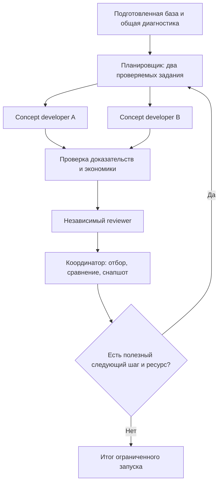

# Итерационный workflow кейса ОТП

Система настроена, но не запущена. Один явно порученный запуск ведёт основной агент через `case-iteration`; отдельный сервер, SDK, расписание или фоновая задача не используются.

## Начало

Нужны условия, доказательства, диагностика и baseline. Wiki готовится по отдельному поручению `knowledge-curation`; workflow не запускает её в обход отложенного решения пользователя. При отсутствии готовой основы или явно назначенного пакета — `needs_inputs`.

Диагностика выполняется один раз и переиспользуется. Планировщик получает компактную историю проверенных подходов и замечаний. В первом цикле он разделяет пространство решений; в следующих обычно одна ветка улучшает лучший вариант, другая проверяет конкурирующий механизм.

## Проверка и отбор

Ветки имеют одинаковые факты и ограничения, разные задания и области записи. Они не читают текущие результаты друг друга. Финансист применяет сопоставимые основания расчёта; новые факты становятся общим обновлением входов.

Reviewer сначала оценивает псевдонимы по фиксированной рубрике без авторства и прежнего ранга. В сравнении есть действующая программа и, начиная со второго цикла, предыдущий лучший вариант без незаметной правки. Обязательные gates имеют приоритет над оценками; допустим отказ всем.

Координатор фиксирует выбор и причины. Гибрид требует самостоятельной проверенной версии. Рост модельного балла сам по себе не считается улучшением.

## Снапшоты и остановка

Раунд сохраняет входы и версии, план, варианты, проверки, review, selection и delta. Закрытый снимок не перезаписывается; best указывает на выбранный результат и допускает null. Изменение данных/рубрики раскрывается и требует повторной проверки прежнего победителя.

По умолчанию максимум три цикла и две ветки. Более ранняя остановка — отсутствие полезной проверки, два цикла без улучшения, нехватка данных/ресурса или запрос пользователя. Лимиты не сбрасываются новым run. Состояние сохраняется для продолжения.

Финализация через `case-storyline` выполняется, если входит в поручение; отправки решения workflow не делает. Завершение ограниченного запуска не означает решение всего кейса.

Подробности: [skill](../../.agents/skills/case-iteration/SKILL.md), [протокол](../../.agents/skills/case-iteration/references/protocol.md), [контракты](../../.agents/skills/case-iteration/references/contracts.md), [матрица ролей](roles-and-skills.md), [хранилище снимков](../../analysis/iterations/README.md).
