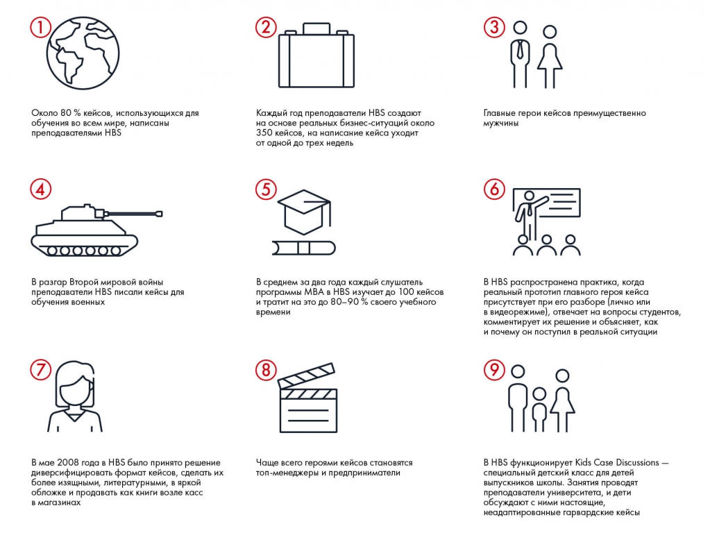

# Иллюстрация: PDF 6, изображение 1

Девять утверждений задания 1.1, расположенные сеткой 3 × 3. Порядок чтения: слева направо, затем следующая строка; истинность проверяется по авторским ответам.

Источник: [PDF 6](../../SOURCE.md#pdf-006).

Необходимая тема: [Практическое задание 1.1: кейсы HBS](../../chapters/01-case-method/exercises/01-hbs.md).

## Текст изображения

> Автоматическая расшифровка. Подписи в сложных слайдах, рукописный текст и порядок колонок могут содержать ошибки OCR. Уточнения, проверенные таблицы и формулы выше имеют приоритет. Не интерпретируйте отсутствие распознанного текста как отсутствие данных в рисунке.

- Около 80% кейсов, использующихся для
- обучения во всем мире, написаны
- преподавателями HBS
- Каждый год преподаватели HBS создают
- на основе реальных бизнес-ситуаций около
- 350 кейсов, на написание кейса уходит
- от одной до трех недель
- В разгар Второй мировой войны
- преподаватели HBS писали кейсы для
- обучения военных
- В среднем за два года каждый слушатель
- программы МВА в HBS изучает до 100 кейсов
- и тратит на это до 80-90% своего учебного
- времени
- В мае 2008 года в HBS было принято решение
- диверсифицировать формат кейсов, сделать их
- более изящными, литературными, в яркой
- обложке и продавать как книги возле касс
- в магазинах
- Чаще всего героями кейсов становятся
- топ-менеджеры и предприниматели
- Главные герои кейсов преимущественно
- мужчины
- В HBS распространена практика, когда
- реальный прототип главного героя кейса
- присутствует при его разборе (лично или
- в видеорежиме), отвечает на вопросы студентов,
- комментирует их решение и объясняет, как
- и почему он поступил в реальной ситуации
- B HBS функционирует Kids Case Discussions -
- специальный детский класс для детей
- выпускников школы. Занятия проводят
- преподаватели университета, и дети
- обсуждают с ними настоящие,
- неадаптированные гарвардские кейсы

## Связанные материалы

[Вернуться к теме](../../chapters/01-case-method/exercises/01-hbs.md) · [Ограничения распознавания](../../meta/issues.md)
