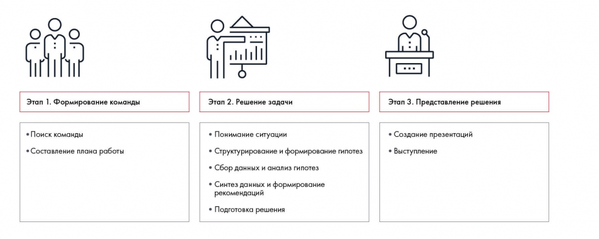

# Иллюстрация: PDF 12, изображение 1

Три этапа: формирование команды, решение задачи, представление решения. Средний этап включает понимание ситуации, структурирование и гипотезы, сбор и анализ данных, синтез и рекомендации, подготовку решения.

Источник: [PDF 12](../../SOURCE.md#pdf-012).

Необходимая тема: [Этапы решения кейса и недельный план](../../chapters/01-case-method/04-solution-stages.md).

## Текст изображения

> Автоматическая расшифровка. Подписи в сложных слайдах, рукописный текст и порядок колонок могут содержать ошибки OCR. Уточнения, проверенные таблицы и формулы выше имеют приоритет. Не интерпретируйте отсутствие распознанного текста как отсутствие данных в рисунке.

- Этап 1. Формирование команды
- • Поиск команды
- • Составление плана работы
- Этап 2. Решение задачи
- • Понимание ситуации
- • Структурирование и формирование гипотез
- • Сбор данных и анализ гипотез
- • Синтез данных и формирование
- рекомендаций
- • Подготовка решения
- Этап 3. Представление решения
- • Создание презентаций
- • Выступление

## Связанные материалы

[Вернуться к теме](../../chapters/01-case-method/04-solution-stages.md) · [Ограничения распознавания](../../meta/issues.md)
