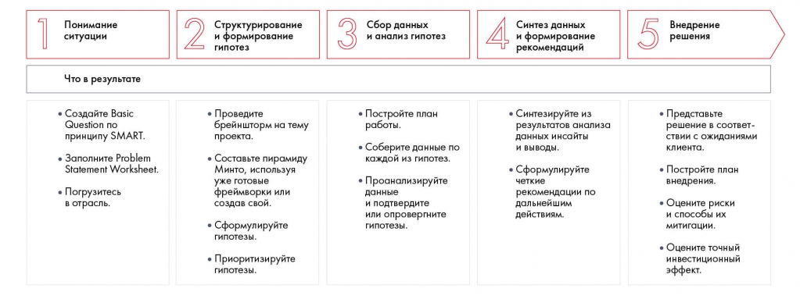

# Иллюстрация: PDF 15, изображение 1

Пять шагов решения и ожидаемые результаты каждого: SMART и PSW; мозговой штурм, пирамида и гипотезы; данные и проверка; инсайты и рекомендации; план внедрения, риски и финансовый эффект.

Источник: [PDF 15](../../SOURCE.md#pdf-015).

Необходимая тема: [Этапы решения кейса и недельный план](../../chapters/01-case-method/04-solution-stages.md).

## Текст изображения

> Автоматическая расшифровка. Подписи в сложных слайдах, рукописный текст и порядок колонок могут содержать ошибки OCR. Уточнения, проверенные таблицы и формулы выше имеют приоритет. Не интерпретируйте отсутствие распознанного текста как отсутствие данных в рисунке.

- Понимание
- ситуации
- Что в результате
- • Создайте Basic
- Question no
- принципу SMART.
- • Заполните Problem
- Statement Worksheet.
- • Погрузитесь
- в отрасль.
- 2
- Структурирование
- и формирование
- гипотез
- • Проведите
- брейншторм на тему
- проекта.
- • Составьте пирамиду
- Минто, используя
- уже готовые
- фреймворки или
- создав свой.
- • Сформулируйте
- гипотезы.
- • Приоритизируйте
- гипотезы.
- 3
- • Постройте план
- работы.
- • Соберите данные по
- каждой из гипотез.
- • Проанализируйте
- данные
- и подтвердите
- или опровергните
- гипотезы.
- Синтез данных
- и формирование
- рекомендаций
- • Синтезируйте из
- результатов анализа
- данных инсайты
- и выводы.
- • Сформулируйте
- четкие
- рекомендации по
- дальнейшим
- действиям.
- 5
- Внедрение
- решения
- • Представьте
- решение в соответ-
- ствии с ожиданиями
- клиента.
- • Постройте план
- внедрения.
- • Оцените риски
- и способы их
- митигации.
- • Оцените точный
- инвестиционный
- эффект.

## Связанные материалы

[Вернуться к теме](../../chapters/01-case-method/04-solution-stages.md) · [Ограничения распознавания](../../meta/issues.md)
