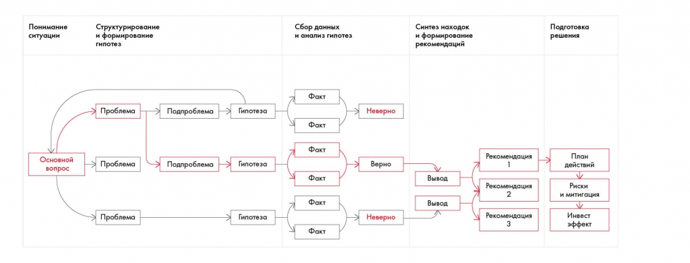

# Иллюстрация: PDF 16, изображение 1

Связь основного вопроса с ветвями проблемы, гипотезами, фактами и рекомендациями. Схема задаёт проверяемую цепочку аргументации.

Источник: [PDF 16](../../SOURCE.md#pdf-016).

Необходимая тема: [Этапы решения кейса и недельный план](../../chapters/01-case-method/04-solution-stages.md).

## Текст изображения

> Автоматическая расшифровка. Подписи в сложных слайдах, рукописный текст и порядок колонок могут содержать ошибки OCR. Уточнения, проверенные таблицы и формулы выше имеют приоритет. Не интерпретируйте отсутствие распознанного текста как отсутствие данных в рисунке.

- Понимание
- ситуации
- Основной
- вопрос
- Структурирование
- и формирование
- гипотез
- Проблема
- Подпроблема
- > Проблема
- Подпроблема
- • Проблема
- Сбор данных
- и анализ гипотез
- Факт
- Гипотеза
- Неверно
- Факт
- Факт
- Гипотеза
- Верно
- Факт
- Факт
- Гипотеза
- Неверно
- Факт
- Синтез находок
- и формирование
- рекомендаций
- Подготовка
- рошених
- Рекомендация
- Вывод
- Рекомендация
- Вывод
- Рекомендация
- План
- действий
- Риски
- и митигация
- Инвест
- эффект

## Связанные материалы

[Вернуться к теме](../../chapters/01-case-method/04-solution-stages.md) · [Ограничения распознавания](../../meta/issues.md)
