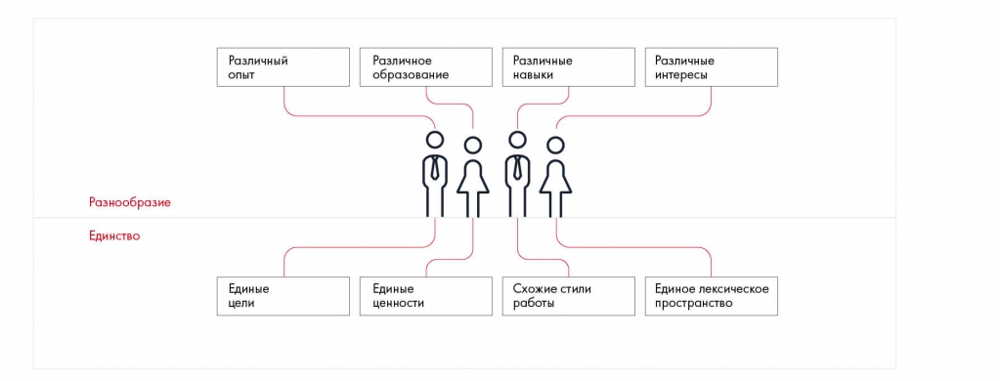

# Иллюстрация: PDF 21, изображение 1

Эффективная команда сочетает разнообразие опыта, образования и навыков с общностью целей и мотивации.

Источник: [PDF 21](../../SOURCE.md#pdf-021).

Необходимая тема: [Формирование эффективной команды](../../chapters/02-teamwork/01-effective-team.md).

## Текст изображения

> Автоматическая расшифровка. Подписи в сложных слайдах, рукописный текст и порядок колонок могут содержать ошибки OCR. Уточнения, проверенные таблицы и формулы выше имеют приоритет. Не интерпретируйте отсутствие распознанного текста как отсутствие данных в рисунке.

- Различный
- ОПЫТ
- Различное
- образование
- Различные
- навыки
- Разнообразие
- Единство
- Единые
- цели
- Единые
- ценности
- Схожие стили
- работы
- Различные
- интересы
- 9 1 91
- Единое лексическое
- пространство

## Связанные материалы

[Вернуться к теме](../../chapters/02-teamwork/01-effective-team.md) · [Ограничения распознавания](../../meta/issues.md)
