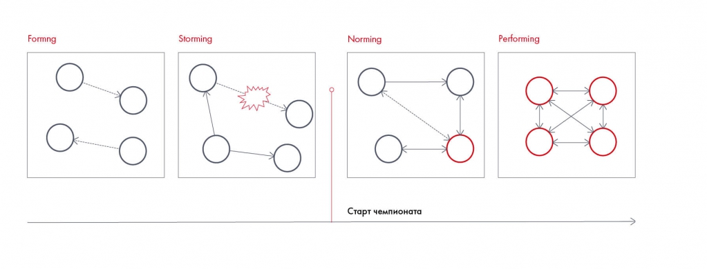

# Иллюстрация: PDF 29, изображение 1

Этапы развития команды: forming, storming, norming, performing. Старт чемпионата отмечен на шкале; рисунок связывает результативность с развитием взаимодействия.

Источник: [PDF 29](../../SOURCE.md#pdf-029).

Необходимая тема: [Командное взаимодействие и обратная связь](../../chapters/02-teamwork/04-interaction.md).

## Текст изображения

> Автоматическая расшифровка. Подписи в сложных слайдах, рукописный текст и порядок колонок могут содержать ошибки OCR. Уточнения, проверенные таблицы и формулы выше имеют приоритет. Не интерпретируйте отсутствие распознанного текста как отсутствие данных в рисунке.

- Formng
- Storming
- Norming
- Старт чемпионата
- Performing

## Связанные материалы

[Вернуться к теме](../../chapters/02-teamwork/04-interaction.md) · [Ограничения распознавания](../../meta/issues.md)
