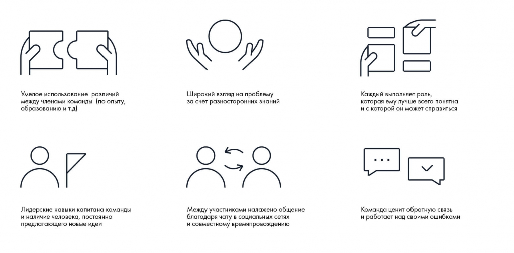

# Иллюстрация: PDF 30, изображение 1

На рисунке приведены элементы: 1555); Умелое использование различий; между членами команды (по опыту,; образованию и т.д); Лидерские навыки капитана команды. Полная текстовая расшифровка приведена отдельно; геометрия и цветовые обозначения сохранены на изображении.

Источник: [PDF 30](../../SOURCE.md#pdf-030).

Необходимая тема: [Командное взаимодействие и обратная связь](../../chapters/02-teamwork/04-interaction.md).

## Текст изображения

> Автоматическая расшифровка. Подписи в сложных слайдах, рукописный текст и порядок колонок могут содержать ошибки OCR. Уточнения, проверенные таблицы и формулы выше имеют приоритет. Не интерпретируйте отсутствие распознанного текста как отсутствие данных в рисунке.

- 1555)
- Умелое использование различий
- между членами команды (по опыту,
- образованию и т.д)
- Лидерские навыки капитана команды
- и наличие человека, постоянно
- предлагающего новые идеи
- nOM
- Широкий взгляд на проблему
- за счет разносторонних знаний
- 050
- Между участниками налажено общение
- благодаря чату в социальных сетях
- и совместному времяпровождению
- Каждый выполняет роль,
- которая ему лучше всего понятна
- и с которой он может справиться
- Команда ценит обратную связь
- и работает над своими ошибками

## Связанные материалы

[Вернуться к теме](../../chapters/02-teamwork/04-interaction.md) · [Ограничения распознавания](../../meta/issues.md)
