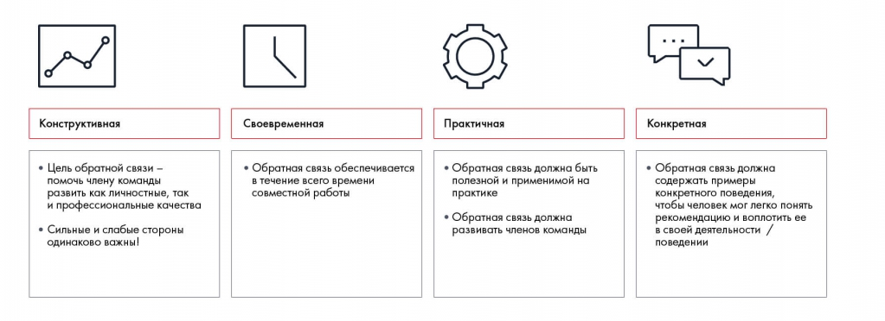

# Иллюстрация: PDF 31, изображение 1

Четыре требования к обратной связи: конструктивность, своевременность, практичность и конкретность. Нужно помогать развитию участника, обсуждать сильные и слабые стороны, давать применимые рекомендации и примеры наблюдаемого поведения.

Источник: [PDF 31](../../SOURCE.md#pdf-031).

Необходимая тема: [Командное взаимодействие и обратная связь](../../chapters/02-teamwork/04-interaction.md).

## Текст изображения

> Автоматическая расшифровка. Подписи в сложных слайдах, рукописный текст и порядок колонок могут содержать ошибки OCR. Уточнения, проверенные таблицы и формулы выше имеют приоритет. Не интерпретируйте отсутствие распознанного текста как отсутствие данных в рисунке.

- Конструктивная
- • Цель обратной связи -
- помочь члену команды
- развить как личностные, так
- и профессиональные качества
- • Сильные и слабые стороны
- Одинаково важны!
- Своевременная
- • Обратная связь обеспечивается
- в течение всего времени
- совместной работы
- Практичная
- • Обратная связь должна быть
- полезной и применимой на
- практике
- • Обратная связь должна
- развивать членов команды
- Конкретная
- • Обратная связь должна
- содержать примеры
- конкретного поведения,
- чтобы человек мог легко понять
- рекомендацию и воплотить ее
- в своей деятельности /
- поведении

## Связанные материалы

[Вернуться к теме](../../chapters/02-teamwork/04-interaction.md) · [Ограничения распознавания](../../meta/issues.md)
