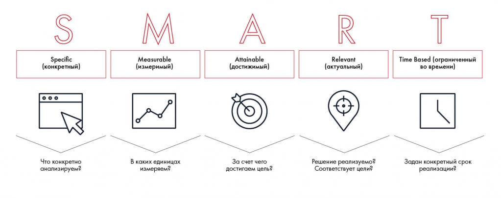

# Иллюстрация: PDF 37, изображение 1

Критерии SMART на рисунке: Specific (конкретный), Measurable (измеримый), Attainable (достижимый), Relevant (актуальный), Time Based (ограниченный во времени). Подписи содержат вопросы к каждому критерию.

Источник: [PDF 37](../../SOURCE.md#pdf-037).

Необходимая тема: [Подход SMART](../../chapters/03-problem-definition/01-smart.md).

## Текст изображения

> Автоматическая расшифровка. Подписи в сложных слайдах, рукописный текст и порядок колонок могут содержать ошибки OCR. Уточнения, проверенные таблицы и формулы выше имеют приоритет. Не интерпретируйте отсутствие распознанного текста как отсутствие данных в рисунке.

- Specific
- (конкретный)
- Что конкретно
- анализируем?
- M
- Measurable
- (измеримый)
- В каких единицах
- измеряем?
- Attainable
- (достижимый)
- R
- Relevant
- (актуальный)
- Time Based (ограниченный
- во времени)
- За счет чего
- достигаем цель?
- Решение реализуемо?
- Соответствует цели?
- Задан конкретный срок
- реализаци?

## Связанные материалы

[Вернуться к теме](../../chapters/03-problem-definition/01-smart.md) · [Ограничения распознавания](../../meta/issues.md)
