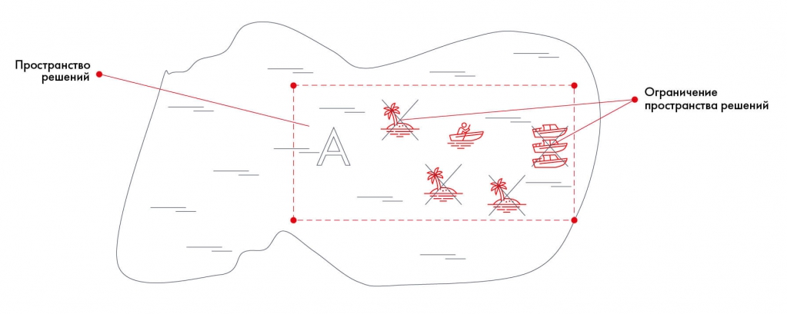

# Иллюстрация: PDF 45, изображение 1

На примере поиска клада зона A обозначает пространство решений — участок озера для поиска. Запрет моторных лодок, ограничение числа судов и мели являются ограничениями способов поиска внутри этого пространства.

Источник: [PDF 45](../../SOURCE.md#pdf-045).

Необходимая тема: [Problem Statement Worksheet: шесть блоков](../../chapters/03-problem-definition/02-psw.md).

## Текст изображения

> Автоматическая расшифровка. Подписи в сложных слайдах, рукописный текст и порядок колонок могут содержать ошибки OCR. Уточнения, проверенные таблицы и формулы выше имеют приоритет. Не интерпретируйте отсутствие распознанного текста как отсутствие данных в рисунке.

- Пространство
- решений •.
- А
- Ограничение
- пространства решений

## Связанные материалы

[Вернуться к теме](../../chapters/03-problem-definition/02-psw.md) · [Ограничения распознавания](../../meta/issues.md)
