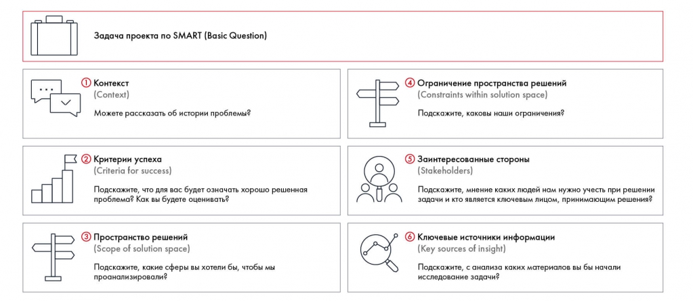

# Иллюстрация: PDF 46, изображение 1

Пустой PSW содержит Basic Question и шесть блоков: контекст, критерии успеха, пространство решений, ограничения, заинтересованные стороны, источники. В каждом блоке даны наводящие вопросы.

Источник: [PDF 46](../../SOURCE.md#pdf-046).

Необходимая тема: [Problem Statement Worksheet: шесть блоков](../../chapters/03-problem-definition/02-psw.md).

## Текст изображения

> Автоматическая расшифровка. Подписи в сложных слайдах, рукописный текст и порядок колонок могут содержать ошибки OCR. Уточнения, проверенные таблицы и формулы выше имеют приоритет. Не интерпретируйте отсутствие распознанного текста как отсутствие данных в рисунке.

- Задача проекта по SMART (Basic Question)
- 1 Контекст
- (Context)
- Можете рассказать об истории проблемы?
- ) Критерии успеха
- (Criteria for success)
- Подскажите, что для вас будет означать хорошо решенная
- проблема? Как вы будете оценивать?
- Пространство решений
- (Scope of solution space)
- Подскажите, какие сферы вы хотели бы, чтобы мы
- проанализировали?
- Ограничение пространства решений
- (Constraints within solution space)
- Подскажите, каковы наши ограничения?
- 5 Заинтересованные стороны
- (Stakeholders)
- Подскажите, мнение каких людей нам нужно учесть при решении
- Задачи и колется ключевы иринающим ре?
- | Ключевые источники информации
- (Key sources of insight)
- Подскажите, с анализа каких материалов вы бы начали
- исследование задачи?

## Связанные материалы

[Вернуться к теме](../../chapters/03-problem-definition/02-psw.md) · [Ограничения распознавания](../../meta/issues.md)
