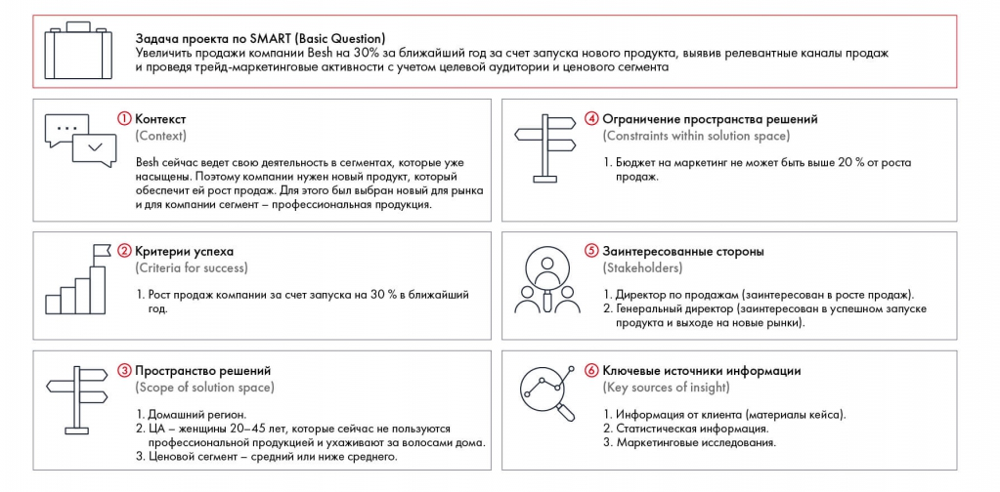

# Иллюстрация: PDF 47, изображение 1

Заполненный PSW Besh связывает рост продаж на 30 % за год с запуском нового продукта, каналами и трейд-маркетингом. Ограничения и заинтересованные стороны перенесены в отдельные блоки.

Источник: [PDF 47](../../SOURCE.md#pdf-047).

Необходимая тема: [Кейс Besh: заполненный PSW](../../chapters/03-problem-definition/examples/02-besh-psw.md).

## Текст изображения

> Автоматическая расшифровка. Подписи в сложных слайдах, рукописный текст и порядок колонок могут содержать ошибки OCR. Уточнения, проверенные таблицы и формулы выше имеют приоритет. Не интерпретируйте отсутствие распознанного текста как отсутствие данных в рисунке.

- Задача проекта по SMART (Basic Question)
- Увеличить продажи компании Besh на 30% за ближайший год за счет запуска нового продукта, выявив релевантные каналы продаж
- и проведя трейд-маркетинговые активности с учетом целевой аудитории и ценового сегмента
- 1 Контекст
- Context)
- Besh сейчас ведет свою деятельность в сегментах, которые уже
- насыщены. Поэтому компании нужен новый продукт, который
- обеспечит ей рост продаж. Для этого был выбран новый для рынка
- и для компании сегмент - профессиональная продукция.
- Ограничение пространства решений
- (Constraints within solution space)
- 1. Бюджет на маркетинг не может быть выше 20 % от роста
- продаж.
- 2 Критерии успеха
- (Criteria for success)
- 1. Рост продаж компании за счет запуска на 30% в ближайший
- 5 Заинтересованные стороны
- (Stakeholders)
- 1. Директор по продажам (заинтересован в росте продаж).
- 2. Генеральный директор (заинтересован в успешном запуске
- продукта и выходе на новые рынки).
- 3) Пространство решений
- (Scope of solution space)
- 1. Домашний регион.
- 2. ЦА - женщины 20-45 лет, которые сейчас не пользуются
- профессиональной продукцией и ухаживают за волосами дома.
- 3. Ценовой сегмент - средний или ниже среднего.
- 6
- ) Ключевые источники информации
- Key sources of insight)
- 1. Информация от клиента (материалы кейса).
- 2. Статистическая информация.
- 3. Маркетинговые исследования.

## Связанные материалы

[Вернуться к теме](../../chapters/03-problem-definition/examples/02-besh-psw.md) · [Ограничения распознавания](../../meta/issues.md)
