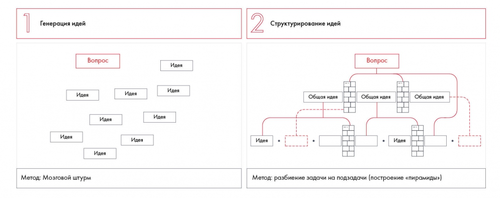

# Иллюстрация: PDF 51, изображение 1

От общего вопроса расходятся идеи мозгового штурма; затем идеи группируются в пирамиду. Показано, что генерация и структурирование являются разными действиями.

Источник: [PDF 51](../../SOURCE.md#pdf-051).

Необходимая тема: [Структурирование и формирование гипотез: общий подход](../../chapters/04-idea-generation/01-structural-thinking.md).

## Текст изображения

> Автоматическая расшифровка. Подписи в сложных слайдах, рукописный текст и порядок колонок могут содержать ошибки OCR. Уточнения, проверенные таблицы и формулы выше имеют приоритет. Не интерпретируйте отсутствие распознанного текста как отсутствие данных в рисунке.

- Генерация идей
- Вопрос
- Идея
- Идея
- Идея
- Идея
- Метод: Мозговой штурм
- Идея
- Идея
- Идея
- Идея
- Идея
- 2
- Структурирование идей
- Вопрос
- Общая идея
- Общая идея
- Общая идея
- Идея
- Идея
- Метод: разбиение задачи на подзадачи (построение «пирамиды»)

## Связанные материалы

[Вернуться к теме](../../chapters/04-idea-generation/01-structural-thinking.md) · [Ограничения распознавания](../../meta/issues.md)
