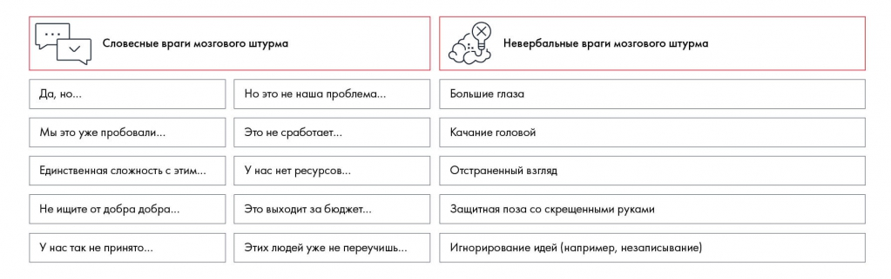

# Иллюстрация: PDF 53, изображение 1

На рисунке приведены элементы: Словесные враги мозгового штурма; Невербальные враги мозгового штурма; Да, но...; Но это не наша проблема...; Большие глаза. Полная текстовая расшифровка приведена отдельно; геометрия и цветовые обозначения сохранены на изображении.

Источник: [PDF 53](../../SOURCE.md#pdf-053).

Необходимая тема: [Мозговой штурм: правила, участники и подготовка](../../chapters/04-idea-generation/02-brainstorm.md).

## Текст изображения

> Автоматическая расшифровка. Подписи в сложных слайдах, рукописный текст и порядок колонок могут содержать ошибки OCR. Уточнения, проверенные таблицы и формулы выше имеют приоритет. Не интерпретируйте отсутствие распознанного текста как отсутствие данных в рисунке.

- Словесные враги мозгового штурма
- Невербальные враги мозгового штурма
- Да, но...
- Но это не наша проблема...
- Большие глаза
- Мы это уже пробовали...
- Единственная сложность с этим...
- Это не сработает...
- Качание головой
- У нас нет ресурсов...
- Это выходит за бюджет....
- Отстраненный взгляд
- Защитная поза со скрещенными руками
- Не ищите от добра добра...
- У нас так не принято...
- Этих людей уже не переучишь...
- Игнорирование идей (например, незаписывание)

## Связанные материалы

[Вернуться к теме](../../chapters/04-idea-generation/02-brainstorm.md) · [Ограничения распознавания](../../meta/issues.md)
