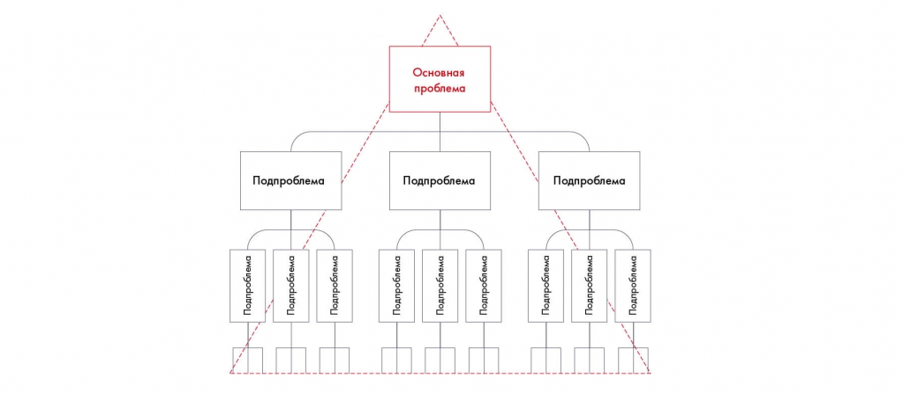

# Иллюстрация: PDF 62, изображение 1

На рисунке приведены элементы: Подпроблема; Подпроблема; Подпроблема; Подпроблема; Подпроблема. Полная текстовая расшифровка приведена отдельно; геометрия и цветовые обозначения сохранены на изображении.

Источник: [PDF 62](../../SOURCE.md#pdf-062).

Необходимая тема: [Как построить структуру решения](../../chapters/05-structuring-hypotheses/01-structure.md).

## Текст изображения

> Автоматическая расшифровка. Подписи в сложных слайдах, рукописный текст и порядок колонок могут содержать ошибки OCR. Уточнения, проверенные таблицы и формулы выше имеют приоритет. Не интерпретируйте отсутствие распознанного текста как отсутствие данных в рисунке.

- Подпроблема
- Подпроблема
- Подпроблема
- Подпроблема
- Подпроблема
- Подпроблема
- Подпроблема
- Подпроблема
- Подпроблема
- Подпроблема
- Подпроблема
- проблема
- Основная

## Связанные материалы

[Вернуться к теме](../../chapters/05-structuring-hypotheses/01-structure.md) · [Ограничения распознавания](../../meta/issues.md)
