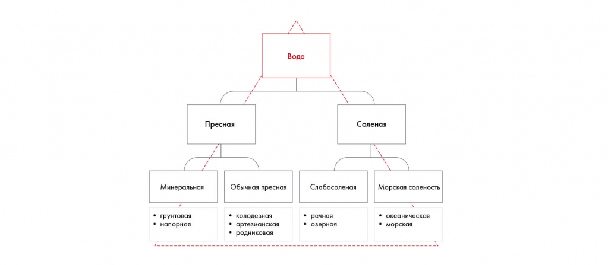

# Иллюстрация: PDF 63, изображение 1

Вода делится на пресную и солёную, затем на подвиды. Пример показывает отношение общего утверждения и более детальных элементов.

Источник: [PDF 63](../../SOURCE.md#pdf-063).

Необходимая тема: [Принцип пирамиды Минто и правило MECE](../../chapters/05-structuring-hypotheses/02-minto-mece.md).

## Текст изображения

> Автоматическая расшифровка. Подписи в сложных слайдах, рукописный текст и порядок колонок могут содержать ошибки OCR. Уточнения, проверенные таблицы и формулы выше имеют приоритет. Не интерпретируйте отсутствие распознанного текста как отсутствие данных в рисунке.

- Вода
- Пресная
- Соленая
- Минеральная
- Обычная пресная
- Слабосоленая
- Морская соленость
- • грунтовая
- • напорная
- • колодезная
- • артезианская
- • родниковая
- • речная
- • озерная
- • океаническая
- • морская

## Связанные материалы

[Вернуться к теме](../../chapters/05-structuring-hypotheses/02-minto-mece.md) · [Ограничения распознавания](../../meta/issues.md)
