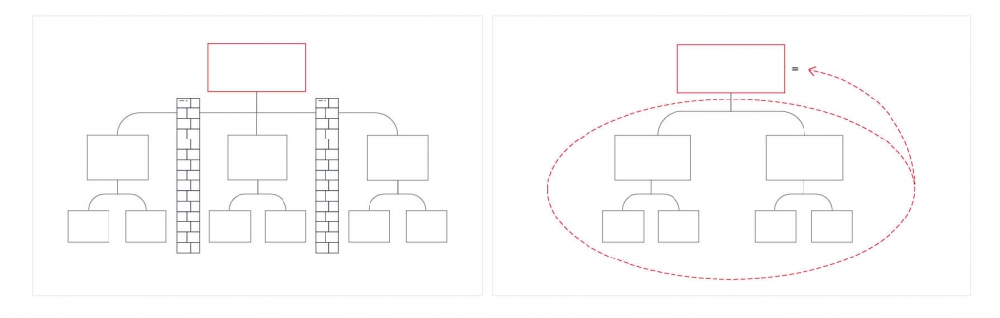

# Иллюстрация: PDF 64, изображение 1

Графическое объяснение MECE: совокупность групп должна покрывать рассматриваемое множество, при этом группы не должны пересекаться. Текстовых подписей на изображении нет.

Источник: [PDF 64](../../SOURCE.md#pdf-064).

Необходимая тема: [Принцип пирамиды Минто и правило MECE](../../chapters/05-structuring-hypotheses/02-minto-mece.md).

## Текст изображения

Текст не распознан. Графическое объяснение MECE: совокупность групп должна покрывать рассматриваемое множество, при этом группы не должны пересекаться. Текстовых подписей на изображении нет.

## Связанные материалы

[Вернуться к теме](../../chapters/05-structuring-hypotheses/02-minto-mece.md) · [Ограничения распознавания](../../meta/issues.md)
