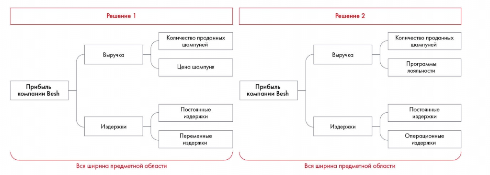

# Иллюстрация: PDF 65, изображение 1

Сопоставлены два дерева прибыли Besh. Прибыль раскладывается на выручку и издержки; ошибка второго варианта состоит в пересечении операционных и постоянных издержек.

Источник: [PDF 65](../../SOURCE.md#pdf-065).

Необходимая тема: [Принцип пирамиды Минто и правило MECE](../../chapters/05-structuring-hypotheses/02-minto-mece.md).

## Текст изображения

> Автоматическая расшифровка. Подписи в сложных слайдах, рукописный текст и порядок колонок могут содержать ошибки OCR. Уточнения, проверенные таблицы и формулы выше имеют приоритет. Не интерпретируйте отсутствие распознанного текста как отсутствие данных в рисунке.

- Решение 1
- Количество проданных
- шампуней
- Выручка
- Цена шампуня
- Прибыль
- компании Besh
- Издержки
- Постоянные
- издержки
- Переменные
- издержки
- Вся ширина предметной области
- Решение 2
- Выручка
- Количество проданных
- шампуней
- Программы
- лояльности
- Прибыль
- компании Besh
- Издержки
- Постоянные
- издержки
- Операционные
- издержки
- Вся ширина предметной области

## Связанные материалы

[Вернуться к теме](../../chapters/05-structuring-hypotheses/02-minto-mece.md) · [Ограничения распознавания](../../meta/issues.md)
