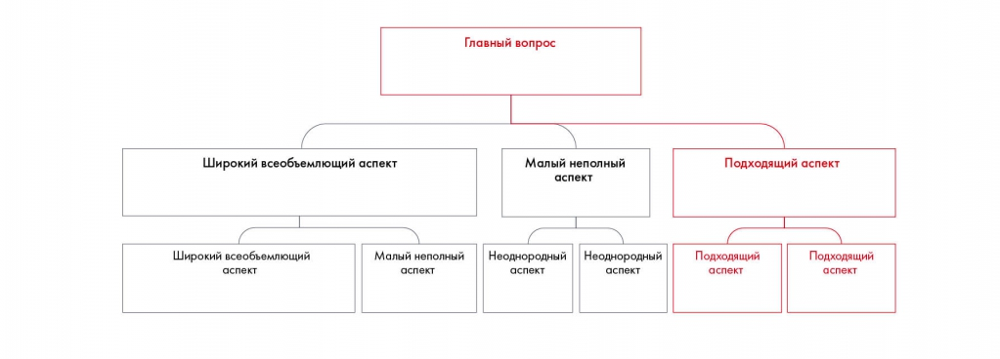

# Иллюстрация: PDF 66, изображение 1

На рисунке приведены элементы: Главный вопрос; Широкий всеобъемлющий аспект; Малый неполный; аспект; Подходящий аспект. Полная текстовая расшифровка приведена отдельно; геометрия и цветовые обозначения сохранены на изображении.

Источник: [PDF 66](../../SOURCE.md#pdf-066).

Необходимая тема: [Принцип пирамиды Минто и правило MECE](../../chapters/05-structuring-hypotheses/02-minto-mece.md).

## Текст изображения

> Автоматическая расшифровка. Подписи в сложных слайдах, рукописный текст и порядок колонок могут содержать ошибки OCR. Уточнения, проверенные таблицы и формулы выше имеют приоритет. Не интерпретируйте отсутствие распознанного текста как отсутствие данных в рисунке.

- Главный вопрос
- Широкий всеобъемлющий аспект
- Малый неполный
- аспект
- Подходящий аспект
- Широкий всеобъемлющий
- Малый неполный
- Неоднородный
- Неоднородный
- аспект
- Подходящий
- аспект
- Подходящий

## Связанные материалы

[Вернуться к теме](../../chapters/05-structuring-hypotheses/02-minto-mece.md) · [Ограничения распознавания](../../meta/issues.md)
