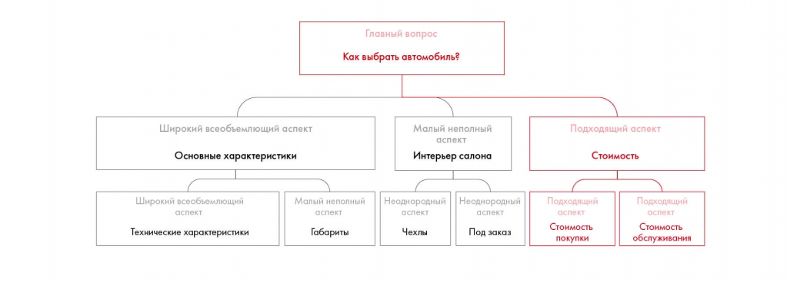

# Иллюстрация: PDF 67, изображение 1

Иллюстрация исходника: «Пример несоразмерного и неоднородного деления ветвей». Подписи и числовые значения вынесены в расшифровку; порядок и связи элементов проверяются по сохранённому изображению.

Источник: [PDF 67](../../SOURCE.md#pdf-067).

Необходимая тема: [Принцип пирамиды Минто и правило MECE](../../chapters/05-structuring-hypotheses/02-minto-mece.md).

## Текст изображения

> Автоматическая расшифровка. Подписи в сложных слайдах, рукописный текст и порядок колонок могут содержать ошибки OCR. Уточнения, проверенные таблицы и формулы выше имеют приоритет. Не интерпретируйте отсутствие распознанного текста как отсутствие данных в рисунке.

- Главный вопрос
- Как выбрать автомобиль?
- Широкий всеобъемлющий аспект
- Основные характеристики
- Малый неполный
- аспект (
- Интерьер салона
- Широкий всеобъемлющий
- Технические характеристики
- Малый неполный
- Габариты
- Неоднородный
- Чехлы
- Неоднородный
- аспект
- Под заказ
- Подходящий аспект
- Стоимость
- Подходящий
- Стоимость
- покупки
- Подходящий
- Стоимость
- обслуживания

## Связанные материалы

[Вернуться к теме](../../chapters/05-structuring-hypotheses/02-minto-mece.md) · [Ограничения распознавания](../../meta/issues.md)
