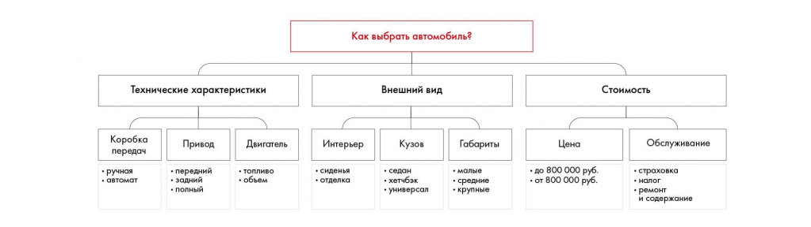

# Иллюстрация: PDF 68, изображение 1

Пример однородного деления выбора автомобиля на технические характеристики и далее на сопоставимые параметры. Подветви уточняют коробку передач, привод и другие характеристики.

Источник: [PDF 68](../../SOURCE.md#pdf-068).

Необходимая тема: [Принцип пирамиды Минто и правило MECE](../../chapters/05-structuring-hypotheses/02-minto-mece.md).

## Текст изображения

> Автоматическая расшифровка. Подписи в сложных слайдах, рукописный текст и порядок колонок могут содержать ошибки OCR. Уточнения, проверенные таблицы и формулы выше имеют приоритет. Не интерпретируйте отсутствие распознанного текста как отсутствие данных в рисунке.

- Технические характеристики
- Коробка
- передач
- • ручная
- • автомат
- Привод
- • передний
- • задний
- • полный
- Двигатель
- • объем
- Как выбрать автомобиль?
- Внешний вид
- Интерьер
- • сиденья
- • отделка
- Кузов
- • седан
- • хетчбэк
- • универсал
- Габариты
- • малые
- * среднив
- • крупные
- Стоимость
- Цена
- • до 800 000 руб.
- • от 800 000 руб.
- Обслуживание
- • страховка
- и содержание

## Связанные материалы

[Вернуться к теме](../../chapters/05-structuring-hypotheses/02-minto-mece.md) · [Ограничения распознавания](../../meta/issues.md)
