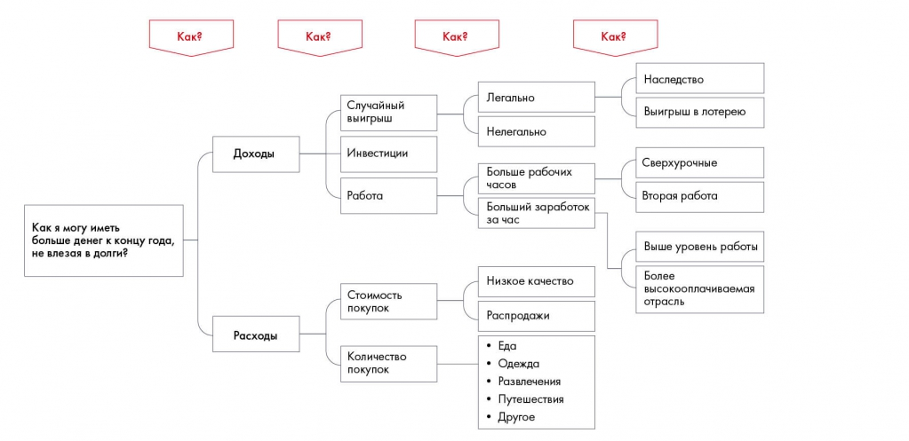

# Иллюстрация: PDF 70, изображение 1

Иллюстрация исходника: «Пример дерева решений». Подписи и числовые значения вынесены в расшифровку; порядок и связи элементов проверяются по сохранённому изображению.

Источник: [PDF 70](../../SOURCE.md#pdf-070).

Необходимая тема: [Дерево решений (Issue Tree)](../../chapters/05-structuring-hypotheses/03-issue-tree.md).

## Текст изображения

> Автоматическая расшифровка. Подписи в сложных слайдах, рукописный текст и порядок колонок могут содержать ошибки OCR. Уточнения, проверенные таблицы и формулы выше имеют приоритет. Не интерпретируйте отсутствие распознанного текста как отсутствие данных в рисунке.

- Как?
- Как?
- Как?
- Как?
- Доходы
- Случайный
- выигрыш
- Инвестиции
- Легально
- Нелегально
- Наследство
- Выигрыш в лотерею
- Работа
- Больше рабочих
- часов
- Больший заработок
- за час
- Сверхурочные
- Вторая работа
- Как я могу иметь
- больше денег к концу года,
- не влезая в долги?
- Стоимость
- покупок
- Расходы
- Количество
- покупок
- Низкое качество
- Распродажи
- • Еда
- • Одежда
- • Развлечения
- • Путешествия
- • Другое
- Выше уровень работы
- Более
- высокооплачиваемая
- отрасль

## Связанные материалы

[Вернуться к теме](../../chapters/05-structuring-hypotheses/03-issue-tree.md) · [Ограничения распознавания](../../meta/issues.md)
