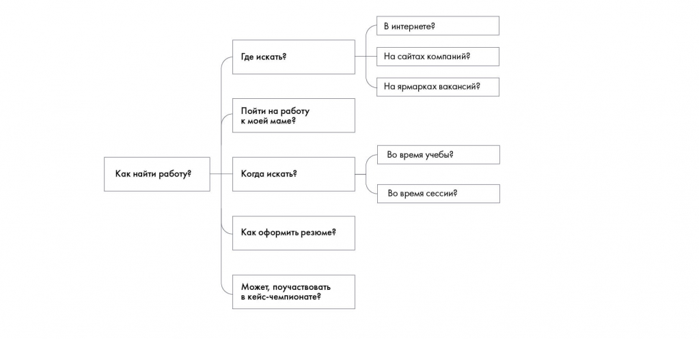

# Иллюстрация: PDF 71, изображение 2

На рисунке приведены элементы: Как найти работу?; Где искать?; Пойти на работу; к моей маме?; Когда искать?. Полная текстовая расшифровка приведена отдельно; геометрия и цветовые обозначения сохранены на изображении.

Источник: [PDF 71](../../SOURCE.md#pdf-071).

Необходимая тема: [Дерево решений (Issue Tree)](../../chapters/05-structuring-hypotheses/03-issue-tree.md).

## Текст изображения

> Автоматическая расшифровка. Подписи в сложных слайдах, рукописный текст и порядок колонок могут содержать ошибки OCR. Уточнения, проверенные таблицы и формулы выше имеют приоритет. Не интерпретируйте отсутствие распознанного текста как отсутствие данных в рисунке.

- Как найти работу?
- Где искать?
- Пойти на работу
- к моей маме?
- Когда искать?
- Как оформить резюме?
- Может, поучаствовать
- в кейс-чемпионате?
- В интернете?
- На сайтах компаний?
- На ярмарках вакансий?
- Во время учебы?
- Во время сессии?

## Связанные материалы

[Вернуться к теме](../../chapters/05-structuring-hypotheses/03-issue-tree.md) · [Ограничения распознавания](../../meta/issues.md)
