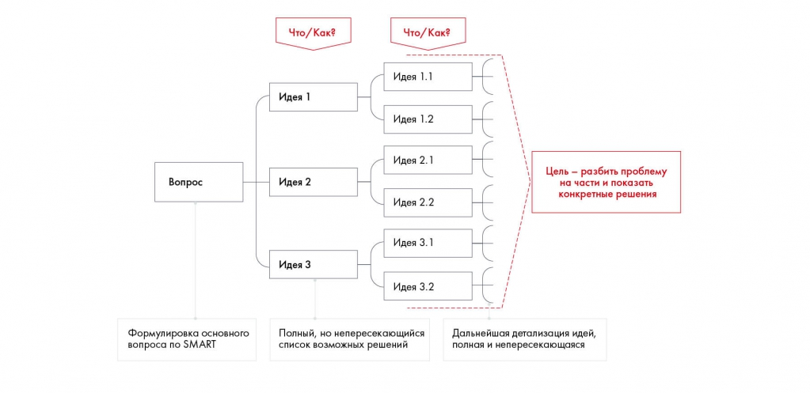

# Иллюстрация: PDF 72, изображение 1

На рисунке приведены элементы: Что / Как?; Что/Как?; Идея 1.1; Идея 1; Идея 1.2. Полная текстовая расшифровка приведена отдельно; геометрия и цветовые обозначения сохранены на изображении.

Источник: [PDF 72](../../SOURCE.md#pdf-072).

Необходимая тема: [Дерево решений (Issue Tree)](../../chapters/05-structuring-hypotheses/03-issue-tree.md).

## Текст изображения

> Автоматическая расшифровка. Подписи в сложных слайдах, рукописный текст и порядок колонок могут содержать ошибки OCR. Уточнения, проверенные таблицы и формулы выше имеют приоритет. Не интерпретируйте отсутствие распознанного текста как отсутствие данных в рисунке.

- Что / Как?
- Что/Как?
- Идея 1.1
- Идея 1
- Идея 1.2
- Идея 2.1
- Вопрос
- Идея 2
- Цель - разбить проблему
- на части и показать
- конкретные решения
- Идея 2.2
- Идея 3.1
- Идея 3
- Идея 3.2
- Формулировка основного
- вопроса по SMART
- Полный, но непересекающийся
- список возможных решений
- Дальнейшая детализация идей,
- полная и непересекающаяся

## Связанные материалы

[Вернуться к теме](../../chapters/05-structuring-hypotheses/03-issue-tree.md) · [Ограничения распознавания](../../meta/issues.md)
