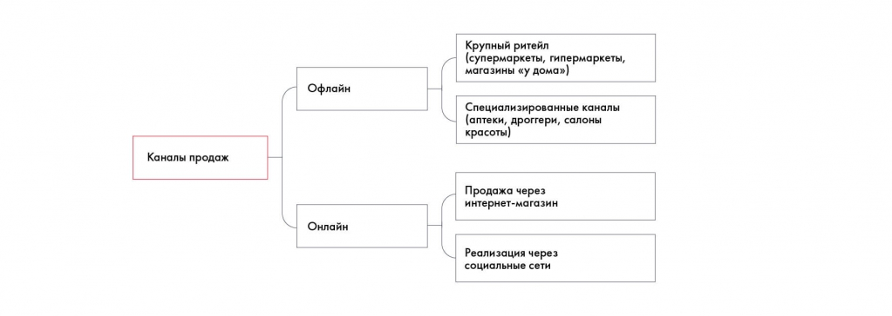

# Иллюстрация: PDF 73, изображение 1

Каналы продаж Besh делятся на офлайн и онлайн. В офлайне выделены крупный ритейл и специализированные каналы, поэтому дерево выявляет ранее пропущенную ветвь онлайн-продаж.

Источник: [PDF 73](../../SOURCE.md#pdf-073).

Необходимая тема: [Кейс Besh: как идеи формируются в пирамиду](../../chapters/05-structuring-hypotheses/examples/01-besh-tree.md).

## Текст изображения

> Автоматическая расшифровка. Подписи в сложных слайдах, рукописный текст и порядок колонок могут содержать ошибки OCR. Уточнения, проверенные таблицы и формулы выше имеют приоритет. Не интерпретируйте отсутствие распознанного текста как отсутствие данных в рисунке.

- Каналы продаж
- Офлайн
- Онлайн
- Крупный ритейл
- (супермаркеты, гипермаркеты,
- магазины «у дома»)
- Специализированные каналы
- (аптеки, дроггери, салоны
- красоты)
- Продажа через
- интернет-магазин
- Реализация через
- социальные сети

## Связанные материалы

[Вернуться к теме](../../chapters/05-structuring-hypotheses/examples/01-besh-tree.md) · [Ограничения распознавания](../../meta/issues.md)
