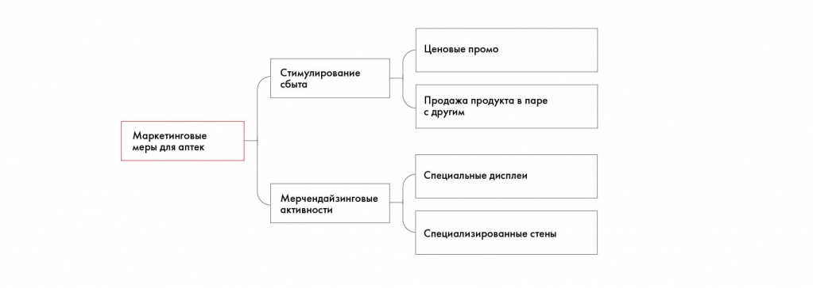

# Иллюстрация: PDF 74, изображение 1

На рисунке приведены элементы: Маркетинговые; меры для аптек; Стимулирование; сбыта; Мерчендайзинговые /. Полная текстовая расшифровка приведена отдельно; геометрия и цветовые обозначения сохранены на изображении.

Источник: [PDF 74](../../SOURCE.md#pdf-074).

Необходимая тема: [Кейс Besh: как идеи формируются в пирамиду](../../chapters/05-structuring-hypotheses/examples/01-besh-tree.md).

## Текст изображения

> Автоматическая расшифровка. Подписи в сложных слайдах, рукописный текст и порядок колонок могут содержать ошибки OCR. Уточнения, проверенные таблицы и формулы выше имеют приоритет. Не интерпретируйте отсутствие распознанного текста как отсутствие данных в рисунке.

- Маркетинговые
- меры для аптек
- Стимулирование
- сбыта
- Мерчендайзинговые /
- активности
- Ценовые промо
- Продажа продукта в паре
- с другим
- Специальные дисплеи
- Специализированные стены

## Связанные материалы

[Вернуться к теме](../../chapters/05-structuring-hypotheses/examples/01-besh-tree.md) · [Ограничения распознавания](../../meta/issues.md)
