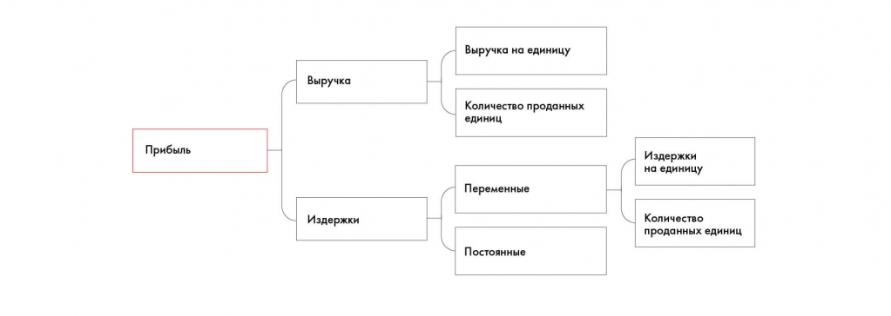

# Иллюстрация: PDF 76, изображение 1

На рисунке приведены элементы: Прибыль; Выручка; Издержки; Выручка на единицу; Количество проданных. Полная текстовая расшифровка приведена отдельно; геометрия и цветовые обозначения сохранены на изображении.

Источник: [PDF 76](../../SOURCE.md#pdf-076).

Необходимая тема: [Фреймворки для общего разбора задачи](../../chapters/05-structuring-hypotheses/04-frameworks-overview.md).

## Текст изображения

> Автоматическая расшифровка. Подписи в сложных слайдах, рукописный текст и порядок колонок могут содержать ошибки OCR. Уточнения, проверенные таблицы и формулы выше имеют приоритет. Не интерпретируйте отсутствие распознанного текста как отсутствие данных в рисунке.

- Прибыль
- Выручка
- Издержки
- Выручка на единицу
- Количество проданных
- единиц
- Переменные
- Постоянные
- Издержки
- на единицу
- Количество
- проданных единиц

## Связанные материалы

[Вернуться к теме](../../chapters/05-structuring-hypotheses/04-frameworks-overview.md) · [Ограничения распознавания](../../meta/issues.md)
