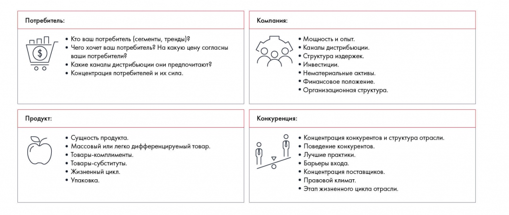

# Иллюстрация: PDF 77, изображение 1

Иллюстрация исходника: «Подход Business Situation Framework». Подписи и числовые значения вынесены в расшифровку; порядок и связи элементов проверяются по сохранённому изображению.

Источник: [PDF 77](../../SOURCE.md#pdf-077).

Необходимая тема: [Фреймворки для общего разбора задачи](../../chapters/05-structuring-hypotheses/04-frameworks-overview.md).

## Текст изображения

> Автоматическая расшифровка. Подписи в сложных слайдах, рукописный текст и порядок колонок могут содержать ошибки OCR. Уточнения, проверенные таблицы и формулы выше имеют приоритет. Не интерпретируйте отсутствие распознанного текста как отсутствие данных в рисунке.

- Потребитель:
- • Кто ваш потребитель (сегменты, тренды)₴
- • Чего хочет ваш потребитель? На какую цену согласны
- ваши потребители?
- • Какие каналы дистрибьюции они предпочитают?
- • Концентрация потребителей и их сила.
- Продукт:
- • Сущность продукта.
- • Массовый или легко дифференцируемый товар.
- • Товары-комплименты.
- • Товары-субституты.
- • Жизненный цикл.
- • Упаковка.
- Компания:
- • Мощность и опыт.
- • Каналы дистрибьюции.
- • Структура издержек.
- • Инвестиции.
- • Нематериальные активы.
- • Финансовое положение.
- • Организационная структура.
- Конкуренция:
- (0)
- • Концентрация конкурентов и структура отрасли.
- • Поведение конкурентов.
- • Лучшие практики.
- • Барьеры входа.
- • Концентрация поставщиков.
- • Правовой климат.
- • Этап жизненного цикла отрасли.

## Связанные материалы

[Вернуться к теме](../../chapters/05-structuring-hypotheses/04-frameworks-overview.md) · [Ограничения распознавания](../../meta/issues.md)
