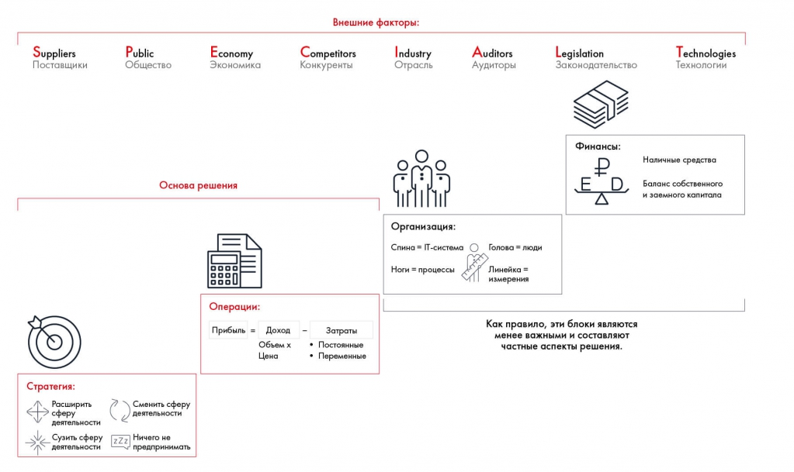

# Иллюстрация: PDF 78, изображение 1

Иллюстрация исходника: «Подход MVM™». Подписи и числовые значения вынесены в расшифровку; порядок и связи элементов проверяются по сохранённому изображению.

Источник: [PDF 78](../../SOURCE.md#pdf-078).

Необходимая тема: [Оценка внутренней и внешней среды](../../chapters/05-structuring-hypotheses/05-environment.md).

## Текст изображения

> Автоматическая расшифровка. Подписи в сложных слайдах, рукописный текст и порядок колонок могут содержать ошибки OCR. Уточнения, проверенные таблицы и формулы выше имеют приоритет. Не интерпретируйте отсутствие распознанного текста как отсутствие данных в рисунке.

- Suppliers
- Поставщики
- Public
- Общество
- Economy
- Экономика
- Competitors
- Конкуренты
- Внешние факторы:
- Industry
- Отрасль
- O
- Основа решения
- Организация:
- Спина = IT-система
- Ноги = процессы
- Операции:
- Прибыль = Доход
- Обьем ×
- Цена
- Затраты
- • Постоянные
- • Переменные
- Стратегия:
- Расширить
- сферу
- деятельности
- Сузить сферу
- деятельности
- Сменить сферу
- деятельности
- Ничего не
- - предпринимать
- Auditors
- Аудиторы
- Legislation
- Законодательство
- Финансы:
- =
- E
- Голова - люди
- Линейка -
- измерения
- Как правило, эти блоки являются
- менее важными и составляют
- частные аспекты решения.
- Technologies
- Технологии
- Наличные средства
- Баланс собственного
- и заемного капитала

## Связанные материалы

[Вернуться к теме](../../chapters/05-structuring-hypotheses/05-environment.md) · [Ограничения распознавания](../../meta/issues.md)
