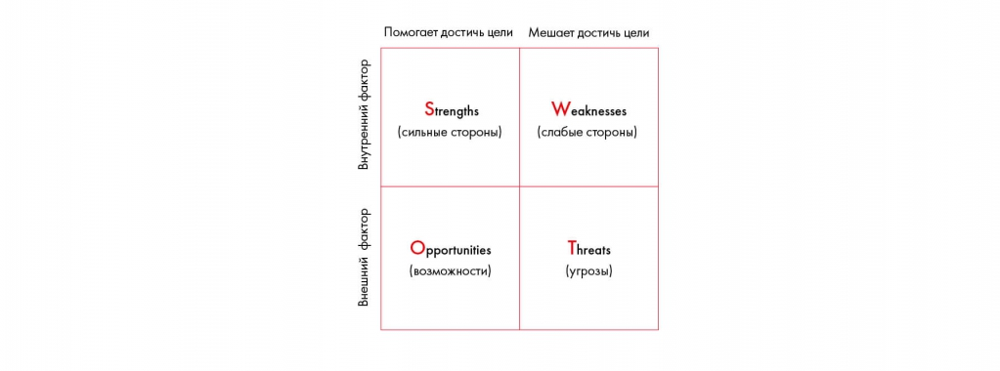

# Иллюстрация: PDF 80, изображение 1

Матрица SWOT разделяет внутренние и внешние факторы, а также помогающие и мешающие достижению цели. В четырёх ячейках находятся Strengths, Weaknesses, Opportunities, Threats.

Источник: [PDF 80](../../SOURCE.md#pdf-080).

Необходимая тема: [Оценка внутренней и внешней среды](../../chapters/05-structuring-hypotheses/05-environment.md).

## Текст изображения

> Автоматическая расшифровка. Подписи в сложных слайдах, рукописный текст и порядок колонок могут содержать ошибки OCR. Уточнения, проверенные таблицы и формулы выше имеют приоритет. Не интерпретируйте отсутствие распознанного текста как отсутствие данных в рисунке.

- Помогает достичь цели
- Мешает достичь цели
- Внутренний фактор
- Strengths
- (сильные стороны)
- Weaknesses
- (слабые стороны)
- Внешний фактор
- Opportunities
- (возможности)
- Threats
- (угрозы)

## Связанные материалы

[Вернуться к теме](../../chapters/05-structuring-hypotheses/05-environment.md) · [Ограничения распознавания](../../meta/issues.md)
