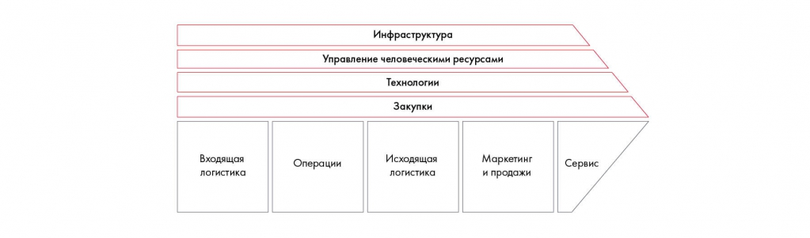

# Иллюстрация: PDF 81, изображение 1

Цепочка создания ценности связывает входящую логистику, операции, исходящую логистику, маркетинг, продажи и обслуживание. Инфраструктура, HR, технологии и закупки поддерживают основные действия.

Источник: [PDF 81](../../SOURCE.md#pdf-081).

Необходимая тема: [Оценка внутренней и внешней среды](../../chapters/05-structuring-hypotheses/05-environment.md).

## Текст изображения

> Автоматическая расшифровка. Подписи в сложных слайдах, рукописный текст и порядок колонок могут содержать ошибки OCR. Уточнения, проверенные таблицы и формулы выше имеют приоритет. Не интерпретируйте отсутствие распознанного текста как отсутствие данных в рисунке.

- Инфраструктура
- Управление человеческими ресурсами
- Технологии
- Закупки
- Входящая
- логистика
- Операции
- Исходящая
- логистика
- Маркетинг
- и продажи
- Сервис

## Связанные материалы

[Вернуться к теме](../../chapters/05-structuring-hypotheses/05-environment.md) · [Ограничения распознавания](../../meta/issues.md)
