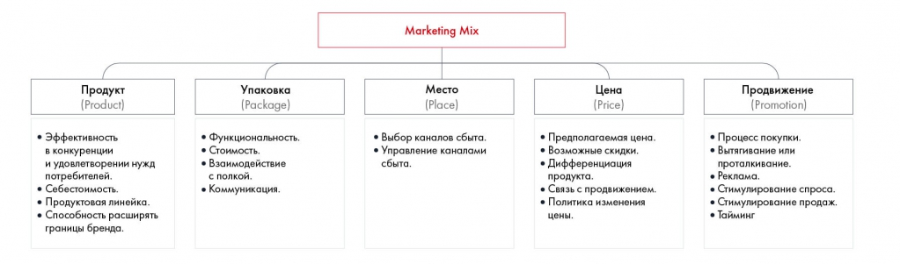

# Иллюстрация: PDF 82, изображение 2

На рисунке приведены элементы: Продукт; (Product); • Эффективность; в конкуренции; и удовлетворении нужд. Полная текстовая расшифровка приведена отдельно; геометрия и цветовые обозначения сохранены на изображении.

Источник: [PDF 82](../../SOURCE.md#pdf-082).

Необходимая тема: [Оценка продукта и выбор стратегии](../../chapters/05-structuring-hypotheses/06-product-strategy.md).

## Текст изображения

> Автоматическая расшифровка. Подписи в сложных слайдах, рукописный текст и порядок колонок могут содержать ошибки OCR. Уточнения, проверенные таблицы и формулы выше имеют приоритет. Не интерпретируйте отсутствие распознанного текста как отсутствие данных в рисунке.

- Продукт
- (Product)
- • Эффективность
- в конкуренции
- и удовлетворении нужд
- потребителей.
- • Себестоимость.
- • Продуктовая линейка.
- • Способность расширять
- границы бренда.
- Упаковка
- (Package)
- • Функциональность.
- • Стоимость.
- • Взаимодействие
- с полкой.
- • Коммуникация.
- Marketing Mix
- Место
- (Place)
- • Выбор каналов сбыта.
- • Управление каналами
- сбыта.
- Цена
- (Price)
- • Предполагаемая цена.
- • Возможные скидки.
- • Дифференциация
- продукта.
- • Связь с продвижением.
- • Политика изменения
- цены.
- Продвижение
- (Promotion)
- • Процесс покупки.
- • Вытягивание или
- проталкивание.
- • Реклама.
- • Стимулирование спроса.
- • Стимулирование продаж.
- • Тайминг

## Связанные материалы

[Вернуться к теме](../../chapters/05-structuring-hypotheses/06-product-strategy.md) · [Ограничения распознавания](../../meta/issues.md)
