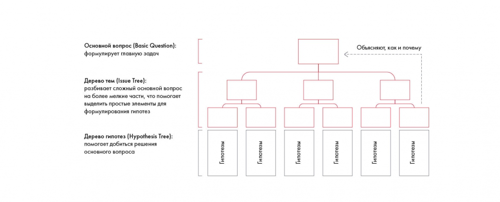

# Иллюстрация: PDF 87, изображение 1

На рисунке приведены элементы: Основной вопрос (Basic Question):; формулирует главную задач; Дерево тем (Issue Tree):; разбивает сложный основной вопрос; на более мелкие части, что помогает. Полная текстовая расшифровка приведена отдельно; геометрия и цветовые обозначения сохранены на изображении.

Источник: [PDF 87](../../SOURCE.md#pdf-087).

Необходимая тема: [Как правильно формулировать гипотезы](../../chapters/05-structuring-hypotheses/07-hypotheses.md).

## Текст изображения

> Автоматическая расшифровка. Подписи в сложных слайдах, рукописный текст и порядок колонок могут содержать ошибки OCR. Уточнения, проверенные таблицы и формулы выше имеют приоритет. Не интерпретируйте отсутствие распознанного текста как отсутствие данных в рисунке.

- Основной вопрос (Basic Question):
- формулирует главную задач
- Дерево тем (Issue Tree):
- разбивает сложный основной вопрос
- на более мелкие части, что помогает
- выделить простые элементы для
- формулирования гипотез
- Дерево гипотез (Hypothesis Tree):
- помогает добиться решения
- основного вопроса
- Гипотезы
- Объясняют, как и почему
- и потезы
- Гипотезы
- Гипотезы
- Гипотезы
- Гипотезы

## Связанные материалы

[Вернуться к теме](../../chapters/05-structuring-hypotheses/07-hypotheses.md) · [Ограничения распознавания](../../meta/issues.md)
