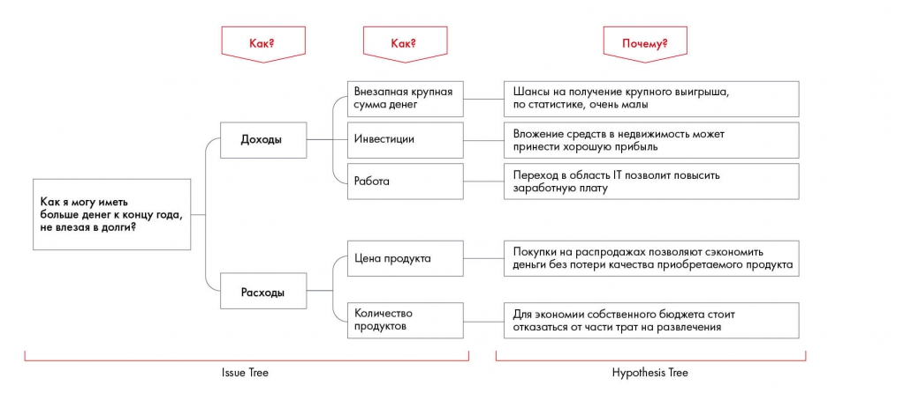

# Иллюстрация: PDF 87, изображение 2

Иллюстрация исходника: «Пример комбинированного дерева решений с гипотезами». Подписи и числовые значения вынесены в расшифровку; порядок и связи элементов проверяются по сохранённому изображению.

Источник: [PDF 87](../../SOURCE.md#pdf-087).

Необходимая тема: [Как правильно формулировать гипотезы](../../chapters/05-structuring-hypotheses/07-hypotheses.md).

## Текст изображения

> Автоматическая расшифровка. Подписи в сложных слайдах, рукописный текст и порядок колонок могут содержать ошибки OCR. Уточнения, проверенные таблицы и формулы выше имеют приоритет. Не интерпретируйте отсутствие распознанного текста как отсутствие данных в рисунке.

- Как?
- Доходы
- Как я могу иметь
- больше денег к концу года,
- не влезая в долги?
- Расходы
- Issue Tree
- Как?
- Внезапная крупная
- сумма денег
- Инвестиции
- Работа
- Цена продукта
- Количество
- продуктов
- Почему?
- ансы на получение крупного выигрыш
- • статистике, очень мал
- Вложение средств в недвижимость может
- принести хорошую прибыль
- Переход в область IT позволит повысить
- заработную плату
- Покупки на распродажах позволяют сэкономить
- деньги без потери качества приобретаемого продукта
- Для экономии собственного бюджета стоит
- отказаться от части трат на развлечения
- Hypothesis Tree

## Связанные материалы

[Вернуться к теме](../../chapters/05-structuring-hypotheses/07-hypotheses.md) · [Ограничения распознавания](../../meta/issues.md)
