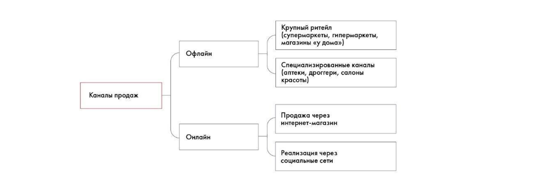

# Иллюстрация: PDF 89, изображение 2

На рисунке приведены элементы: Каналы продаж; Офлайн; Онлайн; рупный ритейл; супермаркеты, гипермаркеты. Полная текстовая расшифровка приведена отдельно; геометрия и цветовые обозначения сохранены на изображении.

Источник: [PDF 89](../../SOURCE.md#pdf-089).

Необходимая тема: [Как правильно формулировать гипотезы](../../chapters/05-structuring-hypotheses/07-hypotheses.md).

## Текст изображения

> Автоматическая расшифровка. Подписи в сложных слайдах, рукописный текст и порядок колонок могут содержать ошибки OCR. Уточнения, проверенные таблицы и формулы выше имеют приоритет. Не интерпретируйте отсутствие распознанного текста как отсутствие данных в рисунке.

- Каналы продаж
- Офлайн
- Онлайн
- рупный ритейл
- супермаркеты, гипермаркеты
- магазины «у дома»)
- .пециализированные каналь
- аптеки, дроггери, салонь
- красоты)
- Продажа через
- интернет-магазин
- Реализация через
- социальные сети

## Связанные материалы

[Вернуться к теме](../../chapters/05-structuring-hypotheses/07-hypotheses.md) · [Ограничения распознавания](../../meta/issues.md)
