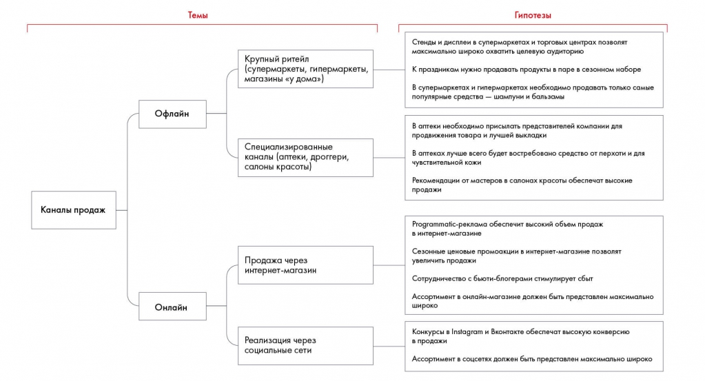

# Иллюстрация: PDF 90, изображение 1

На рисунке приведены элементы: Каналы продаж; Темы; Крупный ритейл; (супермаркеты, гипермаркеты,; магазины «у дома»). Полная текстовая расшифровка приведена отдельно; геометрия и цветовые обозначения сохранены на изображении.

Источник: [PDF 90](../../SOURCE.md#pdf-090).

Необходимая тема: [Как правильно формулировать гипотезы](../../chapters/05-structuring-hypotheses/07-hypotheses.md).

## Текст изображения

> Автоматическая расшифровка. Подписи в сложных слайдах, рукописный текст и порядок колонок могут содержать ошибки OCR. Уточнения, проверенные таблицы и формулы выше имеют приоритет. Не интерпретируйте отсутствие распознанного текста как отсутствие данных в рисунке.

- Каналы продаж
- Темы
- Крупный ритейл
- (супермаркеты, гипермаркеты,
- магазины «у дома»)
- Офлайн
- Специализированные
- аналы (аптеки, дроггери
- салоны красоты)
- Продажа через
- интернет-магазин
- Онлайн
- Реализация через
- социальные сети
- Гипотезы
- Стенды и дисплеи в супермаркетах и торговых центрах позволят
- максимально широко охватить целевую аудиторию
- К праздникам нужно продавать продукты в паре в сезонном наборе
- В супермаркетах и гипермаркетах необходимо продавать только самые
- популярные средства - шампуни и бальзамы
- В аптеки необходимо присылать представителей компании для
- продвижения товара и лучшей выкладки
- В аптеках лучше всего будет востребовано средство от перхоти и для
- чувствительной кожи
- Рекомендации от мастеров в салонах красоты обеспечат высокие
- продажи
- Programmatic-реклама обеспечит высокий обьом продаж
- в интернет-магазине
- Сезонные ценовые промоакции в интернет-магазине позволят
- увеличить продажи
- Сотрудничество с бьюти-блогерами стимулирует сбыт
- Ассортимент в онлайн-магазине должен быть представлен максимально
- широко (
- Конкурсы в Instagram и Вконтакте обеспечат высокую конверсию
- в продажи
- Ассортимент в соцсетях должен быть представлен максимально широко

## Связанные материалы

[Вернуться к теме](../../chapters/05-structuring-hypotheses/07-hypotheses.md) · [Ограничения распознавания](../../meta/issues.md)
