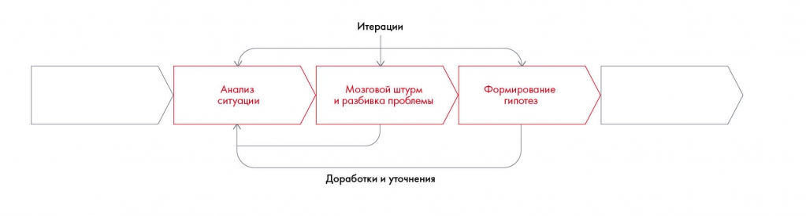

# Иллюстрация: PDF 90, изображение 2

На рисунке приведены элементы: Анализ; ситуации; Итерации; Мозговой штурм; и разбивка проблемы. Полная текстовая расшифровка приведена отдельно; геометрия и цветовые обозначения сохранены на изображении.

Источник: [PDF 90](../../SOURCE.md#pdf-090).

Необходимая тема: [Как правильно формулировать гипотезы](../../chapters/05-structuring-hypotheses/07-hypotheses.md).

## Текст изображения

> Автоматическая расшифровка. Подписи в сложных слайдах, рукописный текст и порядок колонок могут содержать ошибки OCR. Уточнения, проверенные таблицы и формулы выше имеют приоритет. Не интерпретируйте отсутствие распознанного текста как отсутствие данных в рисунке.

- Анализ
- ситуации
- Итерации
- Мозговой штурм
- и разбивка проблемы
- Доработки и уточнени:
- Формирование
- гипотез

## Связанные материалы

[Вернуться к теме](../../chapters/05-structuring-hypotheses/07-hypotheses.md) · [Ограничения распознавания](../../meta/issues.md)
