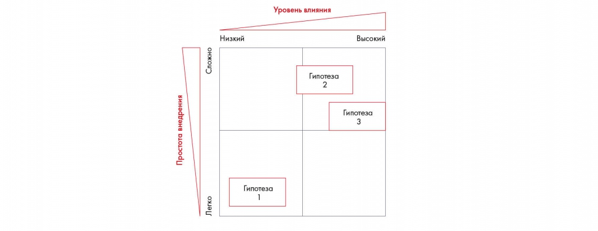

# Иллюстрация: PDF 92, изображение 1

Матрица приоритетов сравнивает гипотезы по влиянию и простоте внедрения. Положение инициатив служит основанием для выбора очередности исследования.

Источник: [PDF 92](../../SOURCE.md#pdf-092).

Необходимая тема: [Расстановка приоритетов](../../chapters/06-prioritization/01-priorities.md).

## Текст изображения

> Автоматическая расшифровка. Подписи в сложных слайдах, рукописный текст и порядок колонок могут содержать ошибки OCR. Уточнения, проверенные таблицы и формулы выше имеют приоритет. Не интерпретируйте отсутствие распознанного текста как отсутствие данных в рисунке.

- Сложно
- Гипотеза
- 2
- Простота внедрения
- Уровень влияния
- Низкий
- Высокий
- Гипотеза
- 3
- Гипотеза
- Легко

## Связанные материалы

[Вернуться к теме](../../chapters/06-prioritization/01-priorities.md) · [Ограничения распознавания](../../meta/issues.md)
