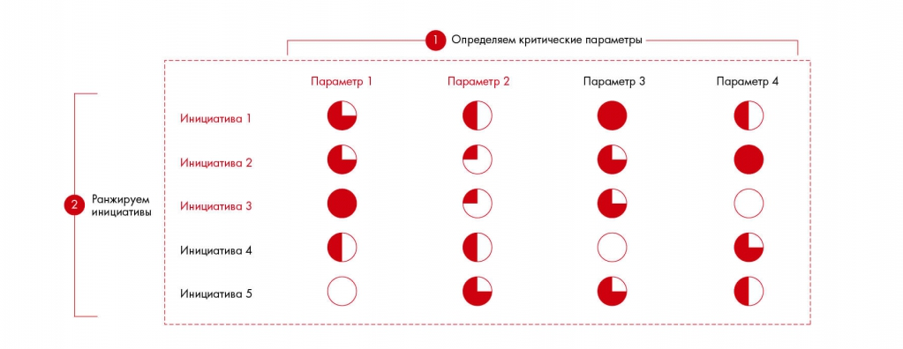

# Иллюстрация: PDF 93, изображение 1

Иллюстрация исходника: «Подход к ранжированию с Harvey’s Balls». Подписи и числовые значения вынесены в расшифровку; порядок и связи элементов проверяются по сохранённому изображению.

Источник: [PDF 93](../../SOURCE.md#pdf-093).

Необходимая тема: [Расстановка приоритетов](../../chapters/06-prioritization/01-priorities.md).

## Текст изображения

> Автоматическая расшифровка. Подписи в сложных слайдах, рукописный текст и порядок колонок могут содержать ошибки OCR. Уточнения, проверенные таблицы и формулы выше имеют приоритет. Не интерпретируйте отсутствие распознанного текста как отсутствие данных в рисунке.

- Определяем критические параметры
- Параметр 3
- Ранжируем
- инициативы
- Инициатива 4
- Инициатива 5
- Параметр 4
- •

## Связанные материалы

[Вернуться к теме](../../chapters/06-prioritization/01-priorities.md) · [Ограничения распознавания](../../meta/issues.md)
