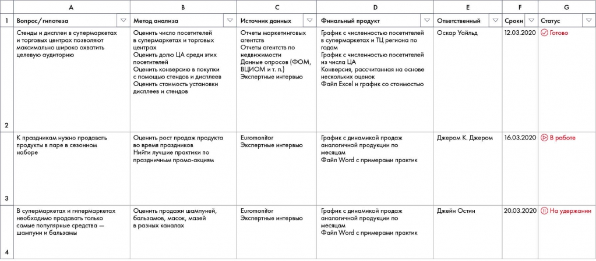

# Иллюстрация: PDF 98, изображение 1

Рабочий план Besh связывает вопрос или гипотезу с необходимыми данными, способом их получения, методом анализа, ответственным и сроком. Каждая строка является отдельной проверкой.

Источник: [PDF 98](../../SOURCE.md#pdf-098).

Необходимая тема: [Работа с информацией и построение плана работ](../../chapters/07-information-search/01-workplan.md).

## Текст изображения

> Автоматическая расшифровка. Подписи в сложных слайдах, рукописный текст и порядок колонок могут содержать ошибки OCR. Уточнения, проверенные таблицы и формулы выше имеют приоритет. Не интерпретируйте отсутствие распознанного текста как отсутствие данных в рисунке.

- 2
- Вопрос/гипотеза
- стенды и дисплеи в супермаркетах
- и торговых центрах позволяют
- максимально широко охватить
- целевую аудиторию
- К праздникам нужно продавать
- продукты в паре в сезонном
- наборе
- В супермаркетах и гипермаркетах
- необходимо продавать только
- самые популярные средства -
- шампуни и бальзамы
- в
- Метод анализа
- Оценить число посетителей
- в супермаркетах и торговых
- центрах
- Оценить долю ЦА среди этих
- посетителей
- Оценить конверсию в покупки
- с помощью стендов и дисплеев
- Оценить стоимость установки
- дисплеев и стендов
- Оценить рост продаж продукта
- во время праздников
- Нийти лучшие практики по
- праздничным промо-акциям
- Оценить продажи шампуней,
- бальзамов, масок, мазей
- в разных каналах
- Источних данных
- Отчеты маркетинговых
- агентств
- Отчеты агентств по
- недвижимости
- Данные опросов (ФОМ,
- ВЦИОМ и т. п.)
- Экспертные интервью
- Euromonitor
- Экспертные интервью
- Euromonitor
- Экспертные интервью
- D
- Финальный продукт
- График с численностью посетителей
- в супермаркетах и ТЦ региона по
- годам
- График с численностью посетителей
- из числа ЦА
- Конверсия, рассчитанная на основе
- нескольких оценок
- Файл Excel и график со стоимостью
- График с динамикой продаж
- аналогичной продукции по
- месяцам
- Файл Word с примерами практик
- График с динамикой продаж
- аналогичной продукции по
- месяцам
- Файл Word с примерами практик
- E
- Ответственный
- Оскар Уайльд
- Джером К. Джером
- Джейн Остин
- G
- Сроки
- 12.03.2020
- Статус
- • Готово
- 16.03.2020
- • В работе
- 20.03.2020
- 1) На удержании

## Связанные материалы

[Вернуться к теме](../../chapters/07-information-search/01-workplan.md) · [Ограничения распознавания](../../meta/issues.md)
