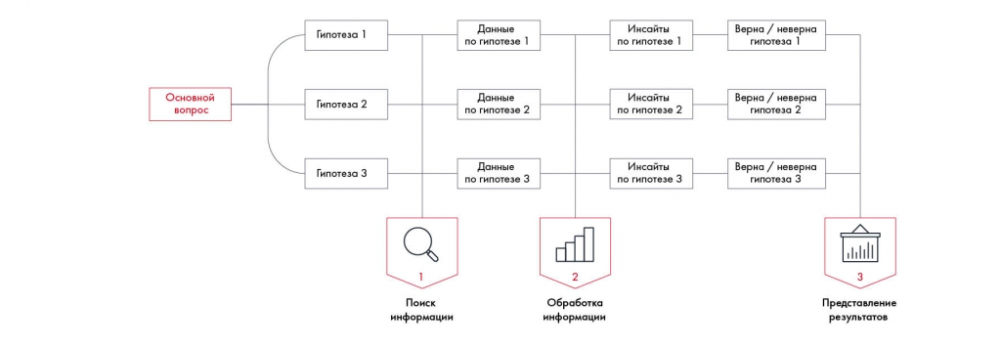

# Иллюстрация: PDF 99, изображение 1

На рисунке приведены элементы: Основной; вопрос; Гипотеза 1; Данные; по гипотезе 1. Полная текстовая расшифровка приведена отдельно; геометрия и цветовые обозначения сохранены на изображении.

Источник: [PDF 99](../../SOURCE.md#pdf-099).

Необходимая тема: [Работа с информацией и построение плана работ](../../chapters/07-information-search/01-workplan.md).

## Текст изображения

> Автоматическая расшифровка. Подписи в сложных слайдах, рукописный текст и порядок колонок могут содержать ошибки OCR. Уточнения, проверенные таблицы и формулы выше имеют приоритет. Не интерпретируйте отсутствие распознанного текста как отсутствие данных в рисунке.

- Основной
- вопрос
- Гипотеза 1
- Данные
- по гипотезе 1
- Инсайты
- по гипотезе 1
- Гипотеза 2
- Данные (
- по гипотезе 2
- Инсайты
- по гипотезе 2
- Гипотеза 3
- Данные
- по гипотезо з
- Инсайты
- по гипотезе 3
- Поиск
- информации
- Обработка
- информации
- Верна / неверна
- гипотеза 1
- Верна / неверна
- гипотеза 2
- Верна / неверна
- гипотеза 3
- hill
- Представление
- результатов

## Связанные материалы

[Вернуться к теме](../../chapters/07-information-search/01-workplan.md) · [Ограничения распознавания](../../meta/issues.md)
