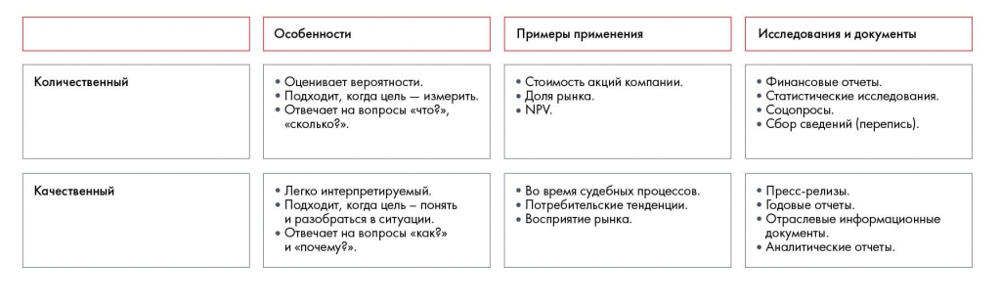

# Иллюстрация: PDF 100, изображение 1

Сравниваются количественный и качественный анализ: измерение и статистические выводы против объяснения причин, мотивов и контекста. Сохранены методы и ограничения каждого подхода.

Источник: [PDF 100](../../SOURCE.md#pdf-100).

Необходимая тема: [Источники информации. Часть 1](../../chapters/07-information-search/02-source-types.md).

## Текст изображения

> Автоматическая расшифровка. Подписи в сложных слайдах, рукописный текст и порядок колонок могут содержать ошибки OCR. Уточнения, проверенные таблицы и формулы выше имеют приоритет. Не интерпретируйте отсутствие распознанного текста как отсутствие данных в рисунке.

- Количественный
- Качественный
- Особенности
- • Оценивает вероятности.
- • Подходит, когда цель - измерить.
- • Отвечает на вопросы «что?»,
- «СКОЛЬКо?».
- • Легко интерпретируемый
- • Подходит, когда цель - понять
- и разобраться в ситуации.
- • Отвечает на вопросы «как?»
- и «почему?».
- Примеры применения
- • Стоимость акций компании.
- • Доля рынка.
- • NPV.
- • Во время судебных процессов.
- • Потребительские тенденции.
- • Восприятие рынка.
- Исследования и документы
- • Финансовые отчеты.
- • Статистические исследования.
- • Соцопросы.
- • Сбор сведений (перепись).
- • Пресс-релизы.
- • Годовые отчеты.
- • Отраслевые информационные
- документы.
- • Аналитические отчеты.

## Связанные материалы

[Вернуться к теме](../../chapters/07-information-search/02-source-types.md) · [Ограничения распознавания](../../meta/issues.md)
