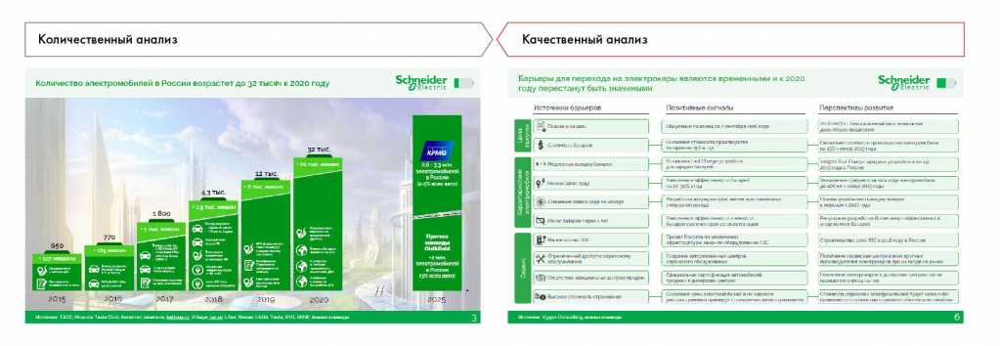

# Иллюстрация: PDF 100, изображение 2

Иллюстрация исходника: «Источник: Changellenge >> Cup Moscow, решение команды Old & Bold». Подписи и числовые значения вынесены в расшифровку; порядок и связи элементов проверяются по сохранённому изображению.

Источник: [PDF 100](../../SOURCE.md#pdf-100).

Необходимая тема: [Источники информации. Часть 1](../../chapters/07-information-search/02-source-types.md).

## Текст изображения

> Автоматическая расшифровка. Подписи в сложных слайдах, рукописный текст и порядок колонок могут содержать ошибки OCR. Уточнения, проверенные таблицы и формулы выше имеют приоритет. Не интерпретируйте отсутствие распознанного текста как отсутствие данных в рисунке.

- Количественный анализ
- HoN 070 У Н Н Н В
- 13 тыс
- 2015
- 2018
- 95.
- 2020
- chneide
- 2025
- Качественный анализ
- Барьоры для перехода из электрокары являются временными и к 2020
- году перестанут быть значимыми
- Источники борьеров
- - Mostrar apunOmer
- hneide
- Перспективы розвития
- ро Ка Скра нада украйєнко но
- Tene ponientes mapey wincen

## Связанные материалы

[Вернуться к теме](../../chapters/07-information-search/02-source-types.md) · [Ограничения распознавания](../../meta/issues.md)
