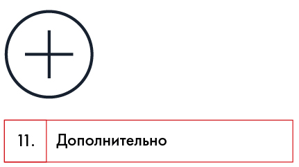

# Иллюстрация: PDF 107, изображение 1

На рисунке приведены элементы: 11.; Дополнительно. Полная текстовая расшифровка приведена отдельно; геометрия и цветовые обозначения сохранены на изображении.

Источник: [PDF 107](../../SOURCE.md#pdf-107).

Необходимая тема: [Поиск информации в интернете](../../chapters/07-information-search/03-web-search.md).

## Текст изображения

> Автоматическая расшифровка. Подписи в сложных слайдах, рукописный текст и порядок колонок могут содержать ошибки OCR. Уточнения, проверенные таблицы и формулы выше имеют приоритет. Не интерпретируйте отсутствие распознанного текста как отсутствие данных в рисунке.

- 11.
- Дополнительно

## Связанные материалы

[Вернуться к теме](../../chapters/07-information-search/03-web-search.md) · [Ограничения распознавания](../../meta/issues.md)
