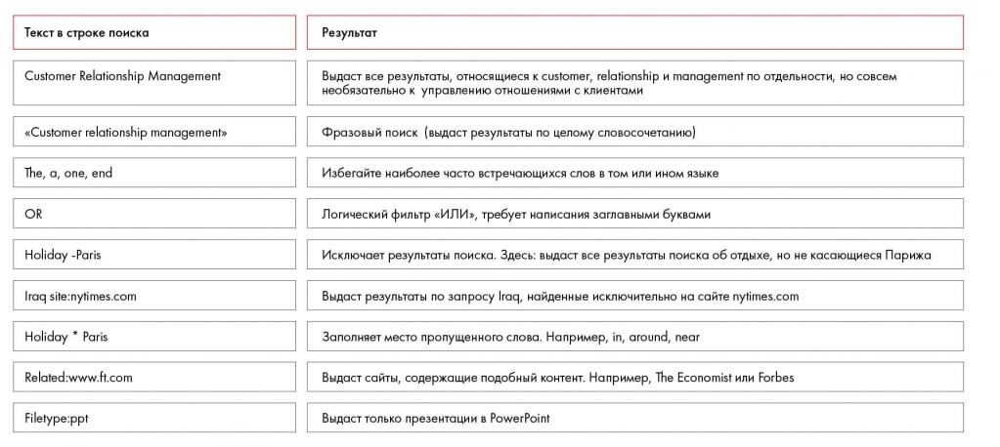

# Иллюстрация: PDF 108, изображение 1

Таблица поисковых запросов показывает кавычки, минус-слово, site: и подстановку звёздочкой. Примеры сохраняют авторские английские запросы.

Источник: [PDF 108](../../SOURCE.md#pdf-108).

Необходимая тема: [Поиск информации в интернете](../../chapters/07-information-search/03-web-search.md).

## Текст изображения

> Автоматическая расшифровка. Подписи в сложных слайдах, рукописный текст и порядок колонок могут содержать ошибки OCR. Уточнения, проверенные таблицы и формулы выше имеют приоритет. Не интерпретируйте отсутствие распознанного текста как отсутствие данных в рисунке.

- Текст в строке поиска
- Customer Relationship Management
- «Customer relationship management»
- The, a, one, end
- Holiday -Paris
- Iraq site:nytimes.com
- Holiday * Paris
- Related:www.ft.com
- Filetype:ppt
- Результат
- бет все результать, отнист ustom , relationship и management по отдельности, но совсем
- необязательно к управлению отношениями с клиентами
- Фразовый поиск (выдаст результаты по целому словосочетанию)
- Избегайте наиболее часто встречающихся слов в том или ином языке
- Логический фильтр «ИЛИ», требует написания заглавными буквами
- Исключает результаты поиска. Здесь: выдаст все результаты поиска об отдыхе, но не касающиеся Парижа
- Выдаст результаты по запросу Iraq, найденные исключительно на сайте nytimes.com
- Заполняет место пропущенного слова. Например, in, around, near
- Выдаст сайты, содержащие подобный контент. Например, The Economist или Forbes
- Выдаст только презентации в PowerPoint

## Связанные материалы

[Вернуться к теме](../../chapters/07-information-search/03-web-search.md) · [Ограничения распознавания](../../meta/issues.md)
