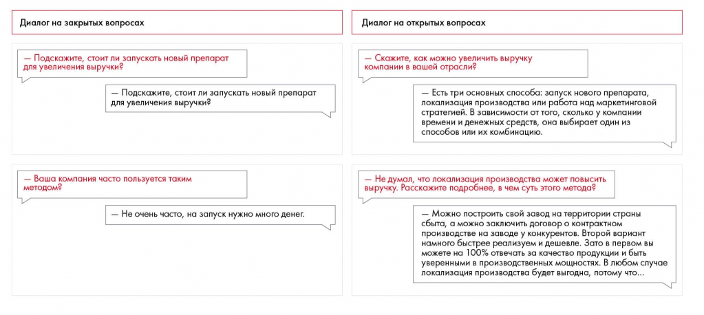

# Иллюстрация: PDF 111, изображение 1

Иллюстрация исходника: «Пример диалога с закрытыми и открытыми вопросами». Подписи и числовые значения вынесены в расшифровку; порядок и связи элементов проверяются по сохранённому изображению.

Источник: [PDF 111](../../SOURCE.md#pdf-111).

Необходимая тема: [Общение с экспертом и проведение интервью](../../chapters/07-information-search/05-interviews.md).

## Текст изображения

> Автоматическая расшифровка. Подписи в сложных слайдах, рукописный текст и порядок колонок могут содержать ошибки OCR. Уточнения, проверенные таблицы и формулы выше имеют приоритет. Не интерпретируйте отсутствие распознанного текста как отсутствие данных в рисунке.

- Диалог на закрытых вопросах
- - Подскажите, стоит ли запускать новый препарат
- для увеличения выручки?
- - Подскажите, стоит ли запускать новый препарат
- для увеличения выручки?
- - Ваша компания часто пользуется таким
- методом?
- Не очень часто, на запуск нужно много денег.
- Диалог на открытых вопросах
- - Скажите, как можно увеличить выручку
- компании в вашей отрасли?
- — Есть три основных способа: запуск нового препарата,
- локализация производства или работа над маркетинговой
- стратегией. В зависимости от того, сколько у компании
- времени и денежных средств, она выбирает один из
- способов или их комбинацию.
- - Не думал, что локализация производства может повысить
- выручку. Расскажите подробнее, в чем суть этого метода?
- - Можно построить свой завод на территории страны
- сбыта, а можно заключить договор о контрактном
- производстве на заводе у конкурентов. Второй вариант
- намного быстрее реализуем и дешевле. Зато в первом вы
- можете на 100% отвечать за качество продукции и быть
- уверенными в производственных мощностях. В любом случае
- локализация производства будет выгодна, потому что...

## Связанные материалы

[Вернуться к теме](../../chapters/07-information-search/05-interviews.md) · [Ограничения распознавания](../../meta/issues.md)
