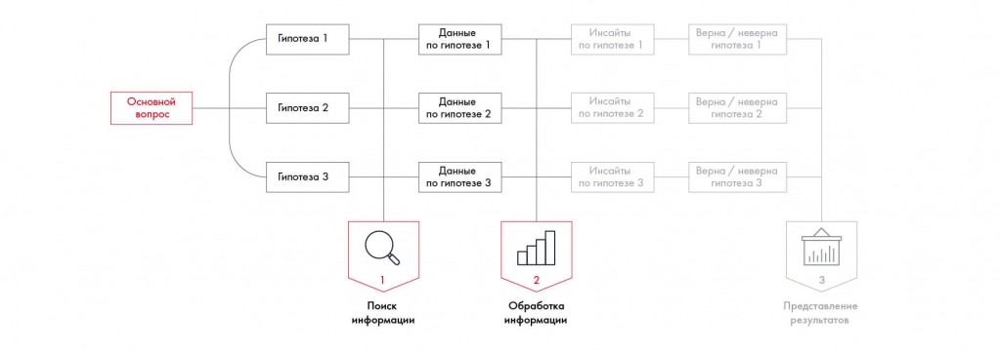

# Иллюстрация: PDF 117, изображение 1

На рисунке приведены элементы: Основной; BONDOC; Гипотеза 1; Данные; по гипотезе 1. Полная текстовая расшифровка приведена отдельно; геометрия и цветовые обозначения сохранены на изображении.

Источник: [PDF 117](../../SOURCE.md#pdf-117).

Необходимая тема: [Обработка и анализ данных](../../chapters/08-analysis-visualization/01-analysis.md).

## Текст изображения

> Автоматическая расшифровка. Подписи в сложных слайдах, рукописный текст и порядок колонок могут содержать ошибки OCR. Уточнения, проверенные таблицы и формулы выше имеют приоритет. Не интерпретируйте отсутствие распознанного текста как отсутствие данных в рисунке.

- Основной
- BONDOC
- Гипотеза 1
- Данные
- по гипотезе 1
- Инсайты
- Гипотеза 2
- Данные
- по гипотезе 2
- Инсайты
- по гипотезе 2
- Гипотеза 3
- Данные
- по гипотезе 3
- Инсайты
- по гипотезе 3
- Поиск
- информации
- Обработка
- информации
- Верна / неверна
- гипотеза її
- Верна / неверна
- гипотеза ?
- Верна / неверна
- гипотеза 3
- gold tirac
- Представление

## Связанные материалы

[Вернуться к теме](../../chapters/08-analysis-visualization/01-analysis.md) · [Ограничения распознавания](../../meta/issues.md)
