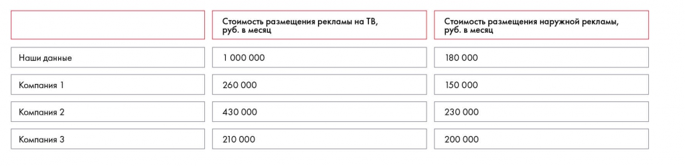

# Иллюстрация: PDF 118, изображение 1

Бенчмаркинг сопоставляет стоимость рекламы на ТВ по собственным данным и трём компаниям. Значительное расхождение требует проверки сопоставимости и качества источников.

Источник: [PDF 118](../../SOURCE.md#pdf-118).

Необходимая тема: [Обработка и анализ данных](../../chapters/08-analysis-visualization/01-analysis.md).

## Табличное представление подписей

> Автоматическое сопоставление по положению строк; пустые ячейки не означают ноль.

| Стоимость размещения рекламы на ТВ, | Стоимость размещения наружной рекламы, руб. в месяц |  |  |
| --- | --- | --- | --- |
| руб. в месяц | Стоимость размещения наружной рекламы, руб. в месяц |  |  |
| Наши данные | 180 000 |  |  |
| 1 000 000 | 180 000 |  |  |
| Компания 1 | 150 000 |  |  |
| 260 000 | 150 000 |  |  |
| 430 000 | 230 000 |  |  |
| Компания 2 | 230 000 |  |  |
| Компания 3 | 200 000 |  |  |
| 210 000 | 200 000 |  |  |

## Текст изображения

> Автоматическая расшифровка. Подписи в сложных слайдах, рукописный текст и порядок колонок могут содержать ошибки OCR. Уточнения, проверенные таблицы и формулы выше имеют приоритет. Не интерпретируйте отсутствие распознанного текста как отсутствие данных в рисунке.

- Наши данные
- Компания 1
- Компания 2
- Компания 3
- Стоимость размещения рекламы на ТВ,
- руб. в месяц
- 1 000 000
- 260 000
- 430 000
- 210 000
- Стоимость размещения наружной рекламы,
- руб. в месяц
- 180 000
- 150 000
- 230 000
- 200 000

## Связанные материалы

[Вернуться к теме](../../chapters/08-analysis-visualization/01-analysis.md) · [Ограничения распознавания](../../meta/issues.md)
