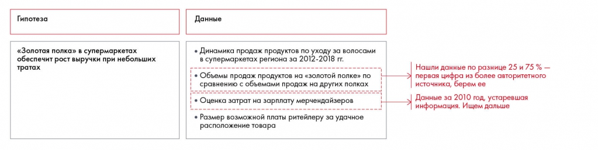

# Иллюстрация: PDF 118, изображение 2

На рисунке приведены элементы: Гипотеза; «Золотая полка» в супермаркетах; обеспечит рост выручки при небольших; тратах; Данные. Полная текстовая расшифровка приведена отдельно; геометрия и цветовые обозначения сохранены на изображении.

Источник: [PDF 118](../../SOURCE.md#pdf-118).

Необходимая тема: [Обработка и анализ данных](../../chapters/08-analysis-visualization/01-analysis.md).

## Текст изображения

> Автоматическая расшифровка. Подписи в сложных слайдах, рукописный текст и порядок колонок могут содержать ошибки OCR. Уточнения, проверенные таблицы и формулы выше имеют приоритет. Не интерпретируйте отсутствие распознанного текста как отсутствие данных в рисунке.

- Гипотеза
- «Золотая полка» в супермаркетах
- обеспечит рост выручки при небольших
- тратах
- Данные
- • Динамика продаж продуктов по уходу за волосами
- в супермаркетах региона за 2012-2018 гг.
- • Объемы продаж продуктов на «золотой полке» по
- сравнению с объемами продаж на других полках
- • Оценка затрат на зарплату мерчендайзеров
- • Размер возможной платы ритейлеру за удачное
- расположение товара
- Нашли данные по разнице 25 и 75 % —
- первая цифра из более авторитетного
- источника, берем ее
- > Данные за 2010 год, устаревшая
- информация. Ищем дальше

## Связанные материалы

[Вернуться к теме](../../chapters/08-analysis-visualization/01-analysis.md) · [Ограничения распознавания](../../meta/issues.md)
